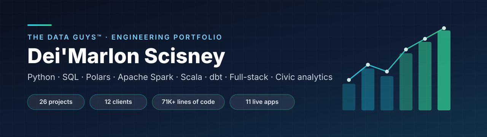
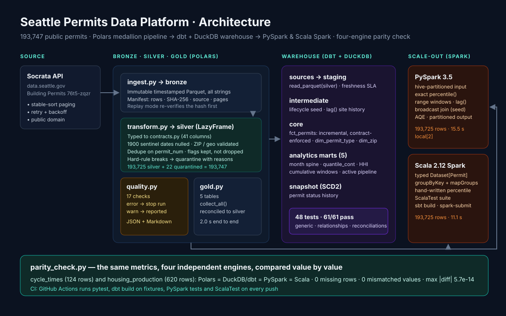
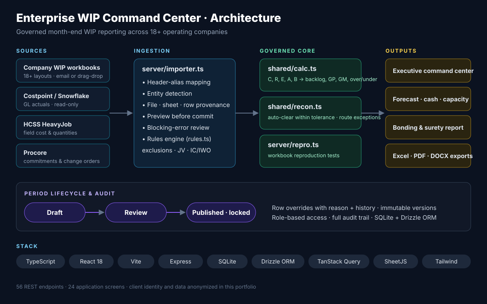
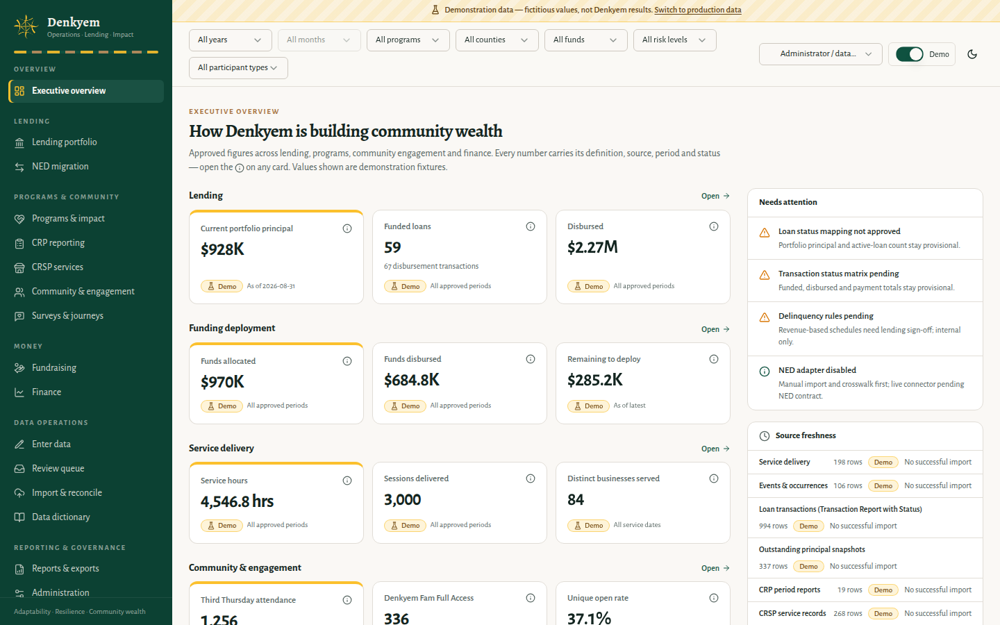
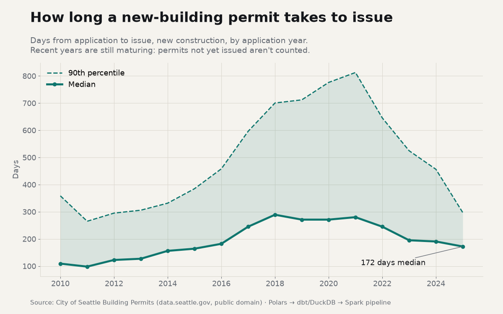
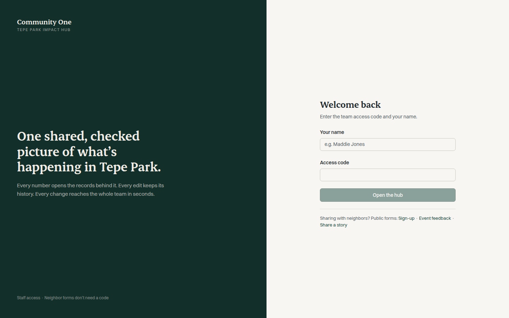
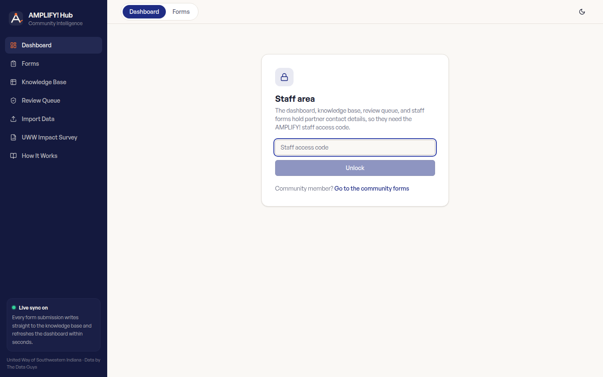
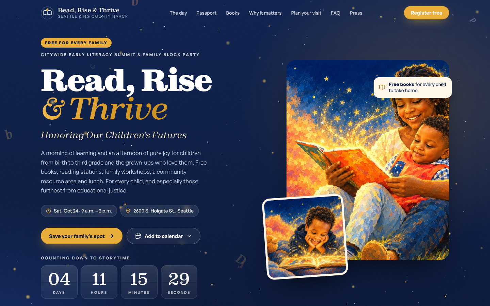
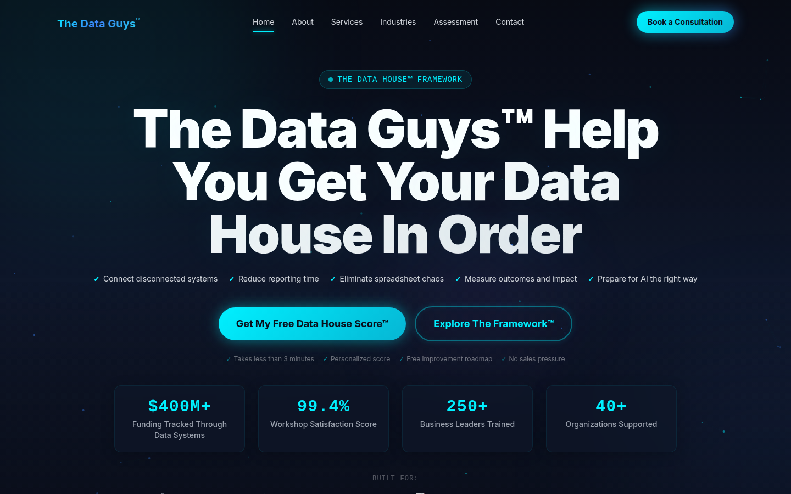
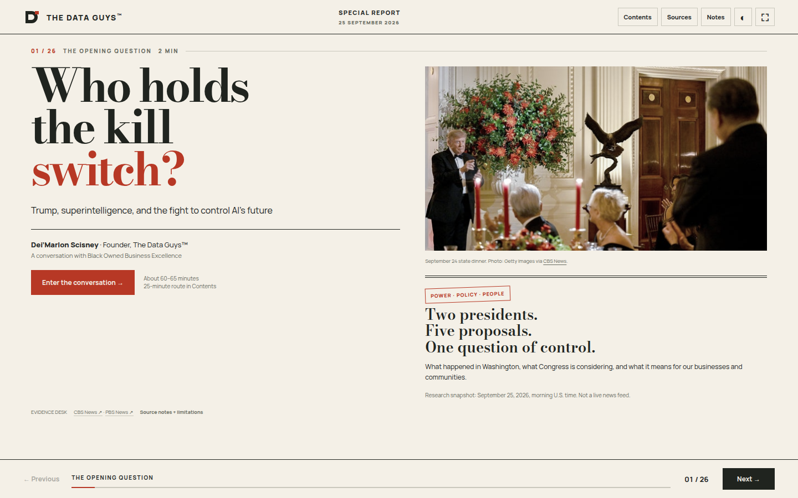

<div align="center">



### Dei'Marlon Scisney · Founder & President, [The Data Guys](https://thedataguys.org)

**Data engineering · Full-stack web applications · Financial reconciliation systems · Public-sector analytics · Evidence-grade reporting**

                        

**[Portfolio website](https://dthedataguy.github.io/the-data-guys-portfolio/)** · **[rowgate](https://github.com/DTheDataGuy/rowgate)**, my open-source data-quality library for Polars

</div>

---

<p align="center">
<a href="#featured-work">Featured work</a> ·
<a href="#project-gallery">Gallery</a> ·
<a href="#projects-by-client">Projects by client</a> ·
<a href="#technical-capabilities">Capabilities</a> ·
<a href="#language-breakdown">Languages</a> ·
<a href="#repository-structure">Structure</a> ·
<a href="#contact">Contact</a>
</p>

## About

I'm a data engineer. I build data systems that people can trust and act on: Python and SQL pipelines, Polars and Apache Spark (PySpark and Scala), dbt warehouses, and the applications that sit on top of them. My work spans enterprise construction-finance platforms that reconcile Costpoint, HCSS, Procore and Snowflake data. It also includes privacy-first civic survey platforms, commissioner-facing economic-impact dashboards for the FIFA World Cup 2026, and the operations and lending systems community organizations run on.

The same principles run through every project:

- **Provenance first.** Every number traces back to a source file, sheet and row, or to a stored response.
- **One calculation library.** The server, UI and exports share formulas, so dashboards and reports never disagree.
- **Evidence classes.** Observed data, reported figures, model estimates and plans are labeled separately and never blended.
- **Safe by default.** Published periods are locked, writes and integrations are gated, small cells are suppressed, and every change has an audit trail.

## Featured work

<table><tr><td width="45%"></td><td>

### [Seattle Permits Data Platform](data-engineering/)
**Independent build · City of Seattle open data (public domain)**

193,747 public building permits, processed four ways. A Polars medallion pipeline enforces a data contract, quarantines bad rows with a reason and runs a 17-check quality gate. A dbt + DuckDB warehouse adds incremental models, enforced contracts, an SCD2 snapshot and 48 tests (61/61 nodes pass). PySpark and Scala Spark jobs recompute the marts, and a parity check compares all four engines value by value: 744 rows, 0 mismatches. CI runs every suite on each push.

`Python 3.12` `Polars` `dbt` `DuckDB` `PySpark` `Scala 2.12` `Parquet` `GitHub Actions`

</td></tr></table>

<table><tr><td width="45%"></td><td>

### [Enterprise WIP Command Center](clients/multi-company-construction-enterprise/enterprise-wip-command-center/)
**Multi-company construction enterprise (anonymized)**

Governed WIP reporting across 18+ operating companies: a shared calculation library, workbook reproduction tests, Costpoint/HCSS/Procore reconciliation, and locked month-end versions. 56 API endpoints and 24 screens.

`TypeScript` `React 18` `Vite` `Express` `SQLite (better-sqlite3)` `Drizzle ORM`

</td></tr></table>

<table><tr><td width="45%"></td><td>

### [FIFA World Cup 2026 Seattle Economic Impact Dashboard](clients/seattle-sports-commission/wc2026-seattle-economic-dashboard/)
**Seattle Sports Commission / Seattle Metropolitan Chamber**

A commissioner-facing FIFA World Cup 2026 economic-impact dashboard: five-method triangulation, a metric register, and evidence classes that keep observed, reported and modeled numbers apart.

`HTML5` `JavaScript` `Chart.js` `CSS3` `Economic modeling`

[Live demo →](https://wc2026-seattle.pplx.app)

</td></tr></table>

<table><tr><td width="45%"></td><td>

### [Seattle Black Diasporic Community Survey Platform](clients/city-of-seattle-black-diasporic-council/community-survey-platform/)
**City of Seattle: Black Diasporic Council feasibility**

A privacy-first civic survey with a restricted executive dashboard: k = 5 small-cell suppression, a separate contact store, a versioned instrument and computed-only analytics.

`TypeScript` `React 18` `Vite` `Express` `SQLite` `Drizzle ORM`

[Live demo →](https://seattle-diaspora-survey.pplx.app)

</td></tr></table>

<table><tr><td width="45%"></td><td>

### [Denkyem Operations, Lending & Impact Platform](clients/denkyem-co-op/operations-lending-impact-platform/)
**Denkyem Co-op**

Contract-driven operations, lending and impact platform: one dataset registry generates forms, imports, validation, templates and the data dictionary.

`TypeScript` `React 18` `Vite` `Express` `SQLite` `Drizzle ORM + drizzle-zod`

[Live demo →](https://denkyem-ops.pplx.app)

</td></tr></table>

## Project gallery

<table>
<tr>
<td width="33%" valign="top"><a href="data-engineering/seattle-permits-polars-pipeline/"></a><p><b><a href="data-engineering/seattle-permits-polars-pipeline/">Seattle Permits Pipeline (Polars)</a></b><br/>Independent build · City of Seattle open data (public domain)</p></td>
<td width="33%" valign="top"><a href="data-engineering/seattle-permits-dbt-duckdb/"></a><p><b><a href="data-engineering/seattle-permits-dbt-duckdb/">Seattle Permits Warehouse (dbt + DuckDB)</a></b><br/>Independent build · City of Seattle open data (public domain)</p></td>
<td width="33%" valign="top"><a href="data-engineering/seattle-permits-spark/"></a><p><b><a href="data-engineering/seattle-permits-spark/">Seattle Permits on Spark (PySpark + Scala)</a></b><br/>Independent build · City of Seattle open data (public domain)</p></td>
</tr>
<tr>
<td width="33%" valign="top"><a href="clients/multi-company-construction-enterprise/enterprise-wip-command-center/"></a><p><b><a href="clients/multi-company-construction-enterprise/enterprise-wip-command-center/">Enterprise WIP Command Center</a></b><br/>Multi-company construction enterprise (anonymized)</p></td>
<td width="33%" valign="top"><a href="clients/seattle-sports-commission/wc2026-seattle-economic-dashboard/"></a><p><b><a href="clients/seattle-sports-commission/wc2026-seattle-economic-dashboard/">FIFA World Cup 2026 Seattle Economic Impact Dashboard</a></b><br/>Seattle Sports Commission / Seattle Metropolitan Chamber</p></td>
<td width="33%" valign="top"><a href="clients/seattle-sports-commission/follow-the-dollar-asu-teaching-story/"></a><p><b><a href="clients/seattle-sports-commission/follow-the-dollar-asu-teaching-story/">Follow the Dollar: Seattle Sports, Data & Policy</a></b><br/>Seattle Sports Commission × Arizona State University</p></td>
</tr>
<tr>
<td width="33%" valign="top"><a href="clients/city-of-seattle-black-diasporic-council/community-survey-platform/"></a><p><b><a href="clients/city-of-seattle-black-diasporic-council/community-survey-platform/">Seattle Black Diasporic Community Survey Platform</a></b><br/>City of Seattle: Black Diasporic Council feasibility</p></td>
<td width="33%" valign="top"><a href="clients/denkyem-co-op/operations-lending-impact-platform/"></a><p><b><a href="clients/denkyem-co-op/operations-lending-impact-platform/">Denkyem Operations, Lending & Impact Platform</a></b><br/>Denkyem Co-op</p></td>
<td width="33%" valign="top"><a href="clients/uw-king-county-play-equity/play-equity-interactive-report/"></a><p><b><a href="clients/uw-king-county-play-equity/play-equity-interactive-report/">King County Play Equity Interactive Report (concept)</a></b><br/>University of Washington / King County Play Equity Coalition</p></td>
</tr>
<tr>
<td width="33%" valign="top"><a href="clients/iurban-teen/impact-dashboard/"></a><p><b><a href="clients/iurban-teen/impact-dashboard/">iUrban Teen Impact Dashboard</a></b><br/>iUrban Teen</p></td>
<td width="33%" valign="top"><a href="clients/community-one/tepe-park-impact-hub/"></a><p><b><a href="clients/community-one/tepe-park-impact-hub/">Tepe Park Impact Hub</a></b><br/>Community One</p></td>
<td width="33%" valign="top"><a href="clients/amplify/community-intelligence-hub/"></a><p><b><a href="clients/amplify/community-intelligence-hub/">AMPLIFY Community Intelligence Hub</a></b><br/>AMPLIFY</p></td>
</tr>
<tr>
<td width="33%" valign="top"><a href="clients/naacp-seattle-king-county-branch-1136/read-rise-thrive-summit-site/"></a><p><b><a href="clients/naacp-seattle-king-county-branch-1136/read-rise-thrive-summit-site/">Read, Rise & Thrive Early Literacy Summit Site</a></b><br/>Seattle–King County NAACP, Branch 1136</p></td>
<td width="33%" valign="top"><a href="the-data-guys/products/stack-and-chill-investing-platform/"></a><p><b><a href="the-data-guys/products/stack-and-chill-investing-platform/">Stack & Chill: Investing & Paper-Trading Platform</a></b><br/>The Data Guys (personal product)</p></td>
<td width="33%" valign="top"><a href="the-data-guys/thedataguys-website/"></a><p><b><a href="the-data-guys/thedataguys-website/">thedataguys.org: Company Website</a></b><br/>The Data Guys</p></td>
</tr>
<tr>
<td width="33%" valign="top"><a href="clients/regional-heavy-civil-contractor/ticket-desk/"></a><p><b><a href="clients/regional-heavy-civil-contractor/ticket-desk/">Ticket Desk: Trucking Ticket Intake & Review</a></b><br/>Regional heavy-civil contractor (anonymized)</p></td>
<td width="33%" valign="top"><a href="clients/naacp-seattle-king-county-branch-1136/letter-studio/"></a><p><b><a href="clients/naacp-seattle-king-county-branch-1136/letter-studio/">Branch 1136 Letter Studio</a></b><br/>Seattle–King County NAACP, Branch 1136</p></td>
<td width="33%" valign="top"><a href="clients/ads/asana-implementation-walkthrough/"></a><p><b><a href="clients/ads/asana-implementation-walkthrough/">Asana Implementation Walkthrough</a></b><br/>ADS</p></td>
</tr>
<tr>
<td width="33%" valign="top"><a href="the-data-guys/presentations/who-holds-the-kill-switch/"></a><p><b><a href="the-data-guys/presentations/who-holds-the-kill-switch/">Who Holds the Kill Switch? Interactive AI-Governance Presentation</a></b><br/>The Data Guys</p></td>
</tr>
</table>

## Projects by client

### Data Engineering: Seattle Permits Data Platform (independent build, public data)

| Project | Stack | Live |
|---|---|---|
| [Seattle Permits Pipeline (Polars)](data-engineering/seattle-permits-polars-pipeline/) | Python 3.12, Polars 2.0, Parquet, PyArrow | — |
| [Seattle Permits Warehouse (dbt + DuckDB)](data-engineering/seattle-permits-dbt-duckdb/) | dbt-core 1.12, DuckDB, SQL, Jinja | — |
| [Seattle Permits on Spark (PySpark + Scala)](data-engineering/seattle-permits-spark/) | Apache Spark 3.5, PySpark, Scala 2.12, sbt | — |

### Multi-Company Construction Enterprise (anonymized)

| Project | Stack | Live |
|---|---|---|
| [Enterprise WIP Command Center](clients/multi-company-construction-enterprise/enterprise-wip-command-center/) | TypeScript, React 18, Vite, Express | — |

### Regional Heavy-Civil Contractor (anonymized)

| Project | Stack | Live |
|---|---|---|
| [Ticket Desk: Trucking Ticket Intake & Review](clients/regional-heavy-civil-contractor/ticket-desk/) | JavaScript (ES2022), HTML5, CSS3, JSON data contracts | — |
| [Month-End Close & Forecast Hub (case study)](clients/regional-heavy-civil-contractor/close-forecast-hub/) | React, TypeScript, Excel / Costpoint GL, Power BI | — |

### Seattle Sports Commission

| Project | Stack | Live |
|---|---|---|
| [FIFA World Cup 2026 Seattle Economic Impact Dashboard](clients/seattle-sports-commission/wc2026-seattle-economic-dashboard/) | HTML5, JavaScript, Chart.js, CSS3 | [Open](https://wc2026-seattle.pplx.app) |
| [Follow the Dollar: Seattle Sports, Data & Policy](clients/seattle-sports-commission/follow-the-dollar-asu-teaching-story/) | HTML5, JavaScript, Chart.js, CSS3 | [Open](https://seattle-sports-data-story.pplx.app) |

### City of Seattle: Black Diasporic Council Feasibility

| Project | Stack | Live |
|---|---|---|
| [Seattle Black Diasporic Community Survey Platform](clients/city-of-seattle-black-diasporic-council/community-survey-platform/) | TypeScript, React 18, Vite, Express | [Open](https://seattle-diaspora-survey.pplx.app) |

### Denkyem Co-op

| Project | Stack | Live |
|---|---|---|
| [Denkyem Operations, Lending & Impact Platform](clients/denkyem-co-op/operations-lending-impact-platform/) | TypeScript, React 18, Vite, Express | [Open](https://denkyem-ops.pplx.app) |

### UW / King County Play Equity Coalition

| Project | Stack | Live |
|---|---|---|
| [King County Play Equity Interactive Report (concept)](clients/uw-king-county-play-equity/play-equity-interactive-report/) | JavaScript, HTML5, CSS3, Data visualization | [Open](https://kc-play-equity-report.pplx.app) |

### Seattle–King County NAACP, Branch 1136

| Project | Stack | Live |
|---|---|---|
| [Read, Rise & Thrive Early Literacy Summit Site](clients/naacp-seattle-king-county-branch-1136/read-rise-thrive-summit-site/) | React, TypeScript, Vite, Tailwind CSS | [Open](https://readrisethrive.pplx.app) |
| [Branch 1136 Letter Studio](clients/naacp-seattle-king-county-branch-1136/letter-studio/) | HTML5, JavaScript, CSS3 (print media), localStorage | — |
| [Executive Letterhead Templates](clients/naacp-seattle-king-county-branch-1136/letterhead-templates/) | HTML5, CSS3 | — |

### Community One

| Project | Stack | Live |
|---|---|---|
| [Tepe Park Impact Hub](clients/community-one/tepe-park-impact-hub/) | React, TypeScript, Vite, Tailwind CSS | [Open](https://tepe-park-impact.pplx.app) |

### AMPLIFY

| Project | Stack | Live |
|---|---|---|
| [AMPLIFY Community Intelligence Hub](clients/amplify/community-intelligence-hub/) | React, TypeScript, Vite, Tailwind CSS | [Open](https://amplify-swi.pplx.app) |
| [AMPLIFY Microsoft Forms + Power Automate + Excel Knowledge Base](clients/amplify/microsoft-forms-system/) | Microsoft Forms, Power Automate, SharePoint, Excel | — |

### iUrban Teen

| Project | Stack | Live |
|---|---|---|
| [iUrban Teen Impact Dashboard](clients/iurban-teen/impact-dashboard/) | JavaScript, HTML5, CSS3, CSV import | [Open](https://iurbanteen-impact.pplx.app) |

### ADS

| Project | Stack | Live |
|---|---|---|
| [Asana Implementation Walkthrough](clients/ads/asana-implementation-walkthrough/) | HTML5, CSS3, JavaScript | — |

### Aerospace NDT Parts Distributor (anonymized)

| Project | Stack | Live |
|---|---|---|
| [RFQ-to-Catalog Item Matching Engine](clients/aerospace-ndt-distributor/rfq-item-matching-engine/) | Python, pandas, regex, difflib | — |

### The Data Guys: Products, Website & Presentations

| Project | Stack | Live |
|---|---|---|
| [Material Recovery Operations API](the-data-guys/products/material-recovery-operations-api/) | Python, FastAPI, SQLAlchemy 2.0 (async), Alembic | — |
| [auntEDNA.ai Machine-Learning Notebooks: LLM Fine-Tuning, RAG & User Data Model](the-data-guys/products/auntedna-ai-ml-notebooks/) | Python, PyTorch, Unsloth (LoRA / QLoRA), Llama 3.2 3B Instruct | — |
| [thedataguys.org: Company Website](the-data-guys/thedataguys-website/) | TypeScript, React 18, Vite, Tailwind CSS | [Open](https://thedataguys.org) |
| [Stack & Chill: Investing & Paper-Trading Platform](the-data-guys/products/stack-and-chill-investing-platform/) | React, TypeScript, Vite, Alpaca Paper Trading API | [Open](https://stackandchill.pplx.app) |
| [Who Holds the Kill Switch? Interactive AI-Governance Presentation](the-data-guys/presentations/who-holds-the-kill-switch/) | HTML5, JavaScript, CSS3 | — |

### Automation & Internal Tooling

| Project | Stack | Live |
|---|---|---|
| [Safe macOS File Organizer](automation/macos-file-organizer/) | Ruby, Shell (.command), Unit tests | — |

## Technical capabilities

| Area | Demonstrated in |
|---|---|
| **Python data processing** (pandas, regex extraction, fuzzy matching, pytest) | RFQ Item Matching Engine |
| **SQL & relational modeling** (T-SQL schema design, filtered indexes, audit tables; ~280 hand-written SQLite queries inside the TypeScript services) | RFQ schema, Enterprise WIP, Denkyem, Community Survey |
| **Machine learning & LLMs** (PyTorch, Unsloth LoRA fine-tuning of Llama 3.2, LangChain RAG, Chroma, S3 data loading) | auntEDNA.ai ML notebooks |
| **Python APIs** (FastAPI, async SQLAlchemy, Alembic migrations, AWS Lambda) | Material Recovery Operations API |
| **Full-stack TypeScript** (React 18, Vite, Express, Drizzle ORM, Zod, TanStack Query) | Enterprise WIP, Denkyem, Community Survey, company website |
| **Data modeling & governed calculations** | `shared/calc.ts`, `shared/recon.ts` (WIP); `shared/contracts.ts` (Denkyem); `shared/analytics.ts` (Survey) |
| **ETL / spreadsheet ingestion** (header aliasing, provenance, preview-before-commit, row-level errors) | WIP importer, Denkyem import pipeline, iUrban Teen Data Studio |
| **Financial systems & month-end close** (WIP, EAC, ITD true-up, over/under-billing, bonding) | Enterprise WIP, Close & Forecast Hub, Ticket Desk |
| **ERP / construction integrations** (Costpoint, Snowflake, HCSS HeavyJob, Procore) | Enterprise WIP, Ticket Desk build spec |
| **Privacy & security engineering** (RBAC, k-anonymity suppression, separated PII stores, release gating, security review) | Community Survey, Denkyem |
| **Data visualization & storytelling** (Chart.js, Recharts, scroll narratives) | WC2026 dashboard, Follow the Dollar, Play Equity report |
| **Economic-impact modeling** (multi-method triangulation, evidence registers) | WC2026 Seattle Economic Impact Dashboard |
| **Low-code automation** (Microsoft Forms, Power Automate, SharePoint/Excel) | AMPLIFY forms system |
| **Scripting & automation** (Ruby, shell, reversible journaled file operations, unit tests) | macOS File Organizer |
| **Fintech APIs** (Alpaca paper trading) | Stack & Chill |

## Language breakdown

| Language | Authored lines | Share |
|---|---:|---:|
| TypeScript | 43,615 | 60.9% |
| HTML | 13,751 | 19.2% |
| JavaScript | 3,849 | 5.4% |
| CSS | 3,810 | 5.3% |
| Ruby | 3,454 | 4.8% |
| Python | 2,244 | 3.1% |
| SQL | 699 | 1.0% |
| Scala | 182 | 0.3% |
| Shell | 16 | 0.0% |
| **Total** | **71,620** | |

Counts cover authored source only and exclude third-party UI primitives, lockfiles, compiled production bundles and generated project templates. SQL also lives inside the TypeScript services (about 280 hand-written queries), which these counts file under TypeScript.

## Repository structure

```
.
├── data-engineering/             # Seattle Permits Data Platform: Polars · dbt + DuckDB · PySpark · Scala Spark
│   ├── seattle-permits-polars-pipeline/
│   ├── seattle-permits-dbt-duckdb/
│   └── seattle-permits-spark/                # pyspark_job/ · scala_job/ (sbt) · parity/
├── clients/                      # Client and partner engagements, one folder per organization
│   ├── multi-company-construction-enterprise/   # Enterprise WIP Command Center
│   ├── regional-heavy-civil-contractor/         # Ticket Desk · Close & Forecast Hub
│   ├── seattle-sports-commission/               # WC2026 dashboard · ASU teaching story
│   ├── city-of-seattle-black-diasporic-council/
│   ├── denkyem-co-op/
│   ├── uw-king-county-play-equity/
│   ├── naacp-seattle-king-county-branch-1136/
│   ├── community-one/
│   ├── amplify/
│   ├── iurban-teen/
│   ├── ads/
│   └── aerospace-ndt-distributor/            # RFQ item matching engine (Python · T-SQL)
├── the-data-guys/                # Company website, products (incl. FastAPI backend) and presentations
├── automation/                   # Scripting and internal tooling
├── .github/workflows/            # CI: pytest, dbt build, PySpark tests, sbt test
└── docs/                         # Interactive portfolio site source, principles, case studies, confidentiality
```

Every project folder has its own `README.md` covering the overview, stack, engineering highlights, code footprint and how to run it.

## Additional documentation

- [Engineering principles](docs/ENGINEERING_PRINCIPLES.md)
- [Case studies without published code](docs/CASE_STUDIES.md)
- [Confidentiality & redaction policy](docs/CONFIDENTIALITY.md)

## Contact

**Dei'Marlon Scisney** · The Data Guys · [thedataguys.org](https://thedataguys.org) · info@thedataguys.org

---

<sub>© 2026 The Data Guys. All rights reserved. This code is published for portfolio review. See [LICENSE](LICENSE).</sub>
