<div align="center">

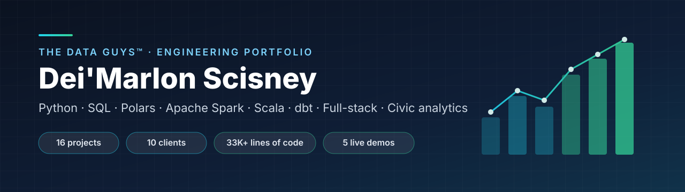

### Dei'Marlon Scisney · Founder & President, [The Data Guys](https://thedataguys.org)

**Data engineering · Full-stack web applications · Financial reconciliation systems · Public-sector analytics · Evidence-grade reporting**

                     

**[Portfolio website](https://dthedataguy.github.io/the-data-guys-portfolio/)** · **16 projects · 10 client organizations · 5 live demos** · **[rowgate](https://github.com/DTheDataGuy/rowgate)**, my open-source data-quality library for Polars

</div>

---

<p align="center">
<a href="#featured-work">Featured work</a> ·
<a href="#project-gallery">Gallery</a> ·
<a href="#projects-by-client">Projects by client</a> ·
<a href="#technical-capabilities">Capabilities</a> ·
<a href="#language-breakdown">Languages</a> ·
<a href="#repository-structure">Structure</a> ·
<a href="#contact">Contact</a>
</p>

## About

I'm a data engineer. I build data systems that people can trust and act on: Python and SQL pipelines, Polars and Apache Spark (PySpark and Scala), dbt warehouses, and the applications that sit on top of them. My work spans enterprise construction-finance platforms that reconcile Costpoint, HCSS, Procore and Snowflake data. It also includes privacy-first civic survey platforms, commissioner-facing economic-impact dashboards for the FIFA World Cup 2026, and the operations and lending systems community organizations run on.

The same principles run through every project:

- **Provenance first.** Every number traces back to a source file, sheet and row, or to a stored response.
- **One calculation library.** The server, UI and exports share formulas, so dashboards and reports never disagree.
- **Evidence classes.** Observed data, reported figures, model estimates and plans are labeled separately and never blended.
- **Safe by default.** Published periods are locked, writes and integrations are gated, small cells are suppressed, and every change has an audit trail.

## Featured work

<table><tr><td width="45%">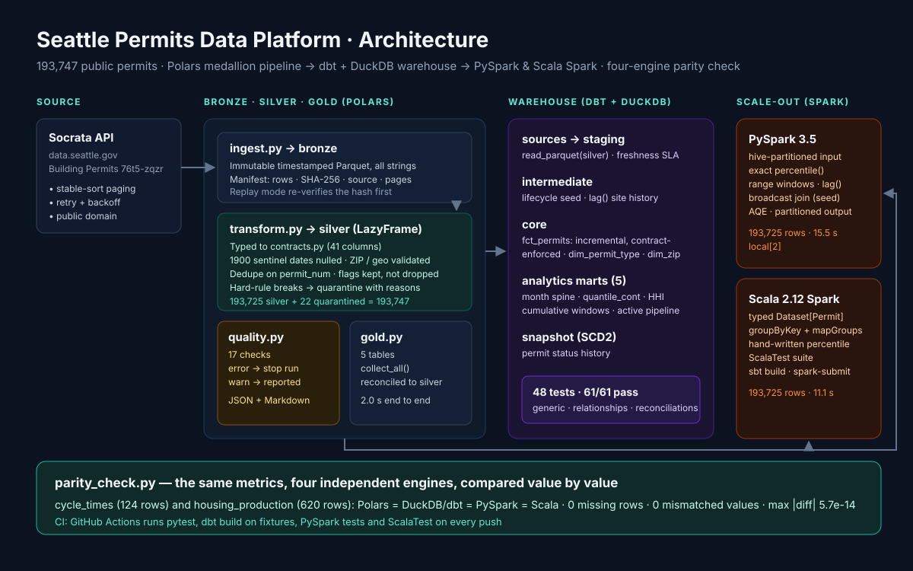</td><td>

### [Seattle Permits Data Platform](data-engineering/)
**Independent build · City of Seattle open data (public domain)**

193,747 public building permits, processed four ways. A Polars medallion pipeline enforces a data contract, quarantines bad rows with a reason and runs a 17-check quality gate. A dbt + DuckDB warehouse adds incremental models, enforced contracts, an SCD2 snapshot and 48 tests (61/61 nodes pass). PySpark and Scala Spark jobs recompute the marts, and a parity check compares all four engines value by value: 744 rows, 0 mismatches. CI runs every suite on each push.

`Python 3.12` `Polars` `dbt` `DuckDB` `PySpark` `Scala 2.12` `Parquet` `GitHub Actions`

</td></tr></table>

<table><tr><td width="45%">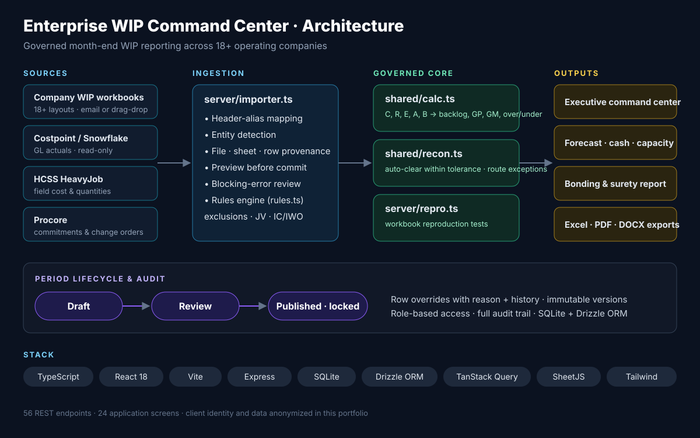</td><td>

### [Enterprise WIP Command Center](clients/multi-company-construction-enterprise/enterprise-wip-command-center/)
**Multi-company construction enterprise (anonymized)**

Governed WIP reporting across 18+ operating companies: a shared calculation library, workbook reproduction tests, Costpoint/HCSS/Procore reconciliation, and locked month-end versions. 56 API endpoints and 24 screens.

`TypeScript` `React 18` `Vite` `Express` `SQLite (better-sqlite3)` `Drizzle ORM`

</td></tr></table>

<table><tr><td width="45%">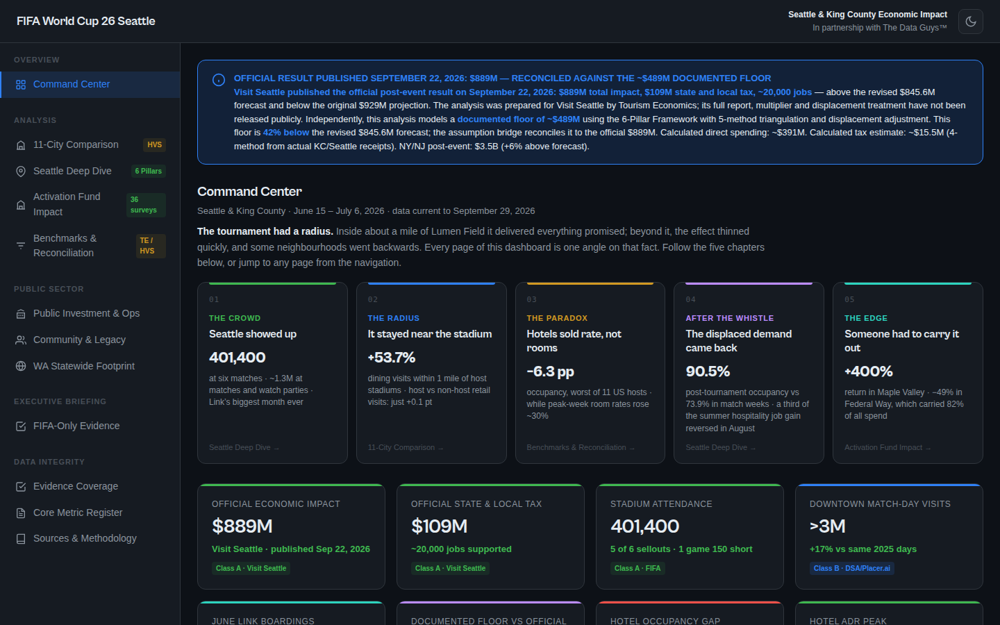</td><td>

### [FIFA World Cup 2026 Seattle Economic Impact Dashboard](clients/regional-sports-commission/wc2026-seattle-economic-dashboard/)
**Regional sports commission (anonymized)**

A commissioner-facing FIFA World Cup 2026 economic-impact dashboard: five-method triangulation, a metric register, and evidence classes that keep observed, reported and modeled numbers apart.

`HTML5` `JavaScript` `Chart.js` `CSS3` `Economic modeling`

[Live demo →](https://dthedataguy.github.io/the-data-guys-portfolio/demos/world-cup-economic-dashboard/)

</td></tr></table>

<table><tr><td width="45%">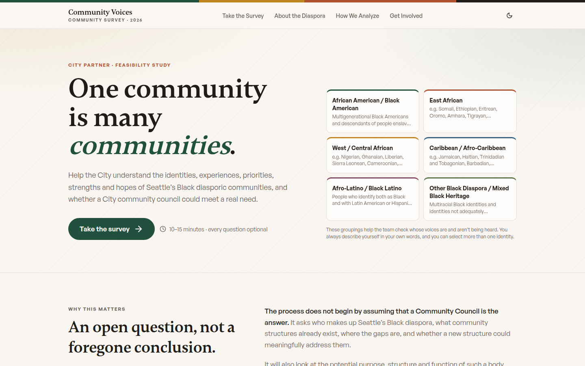</td><td>

### [Community Council Feasibility Survey Platform](clients/municipal-community-council-study/community-survey-platform/)
**Municipal community-council feasibility study (anonymized)**

A privacy-first civic survey with a restricted executive dashboard: k = 5 small-cell suppression, a separate contact store, a versioned instrument and computed-only analytics.

`TypeScript` `React 18` `Vite` `Express` `SQLite` `Drizzle ORM`

</td></tr></table>

<table><tr><td width="45%">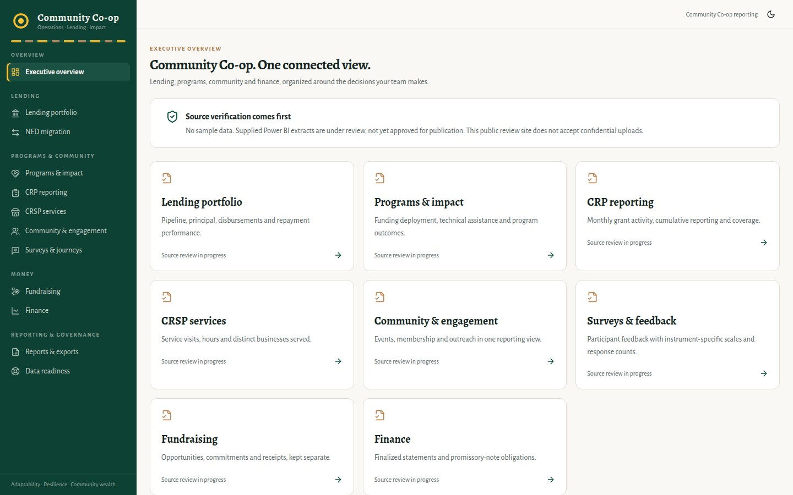</td><td>

### [Co-op Operations, Lending & Impact Platform](clients/community-cooperative/operations-lending-impact-platform/)
**Community lending cooperative (anonymized)**

Contract-driven operations, lending and impact platform: one dataset registry generates forms, imports, validation, templates and the data dictionary.

`TypeScript` `React 18` `Vite` `Express` `SQLite` `Drizzle ORM + drizzle-zod`

</td></tr></table>

## Project gallery

<table>
<tr>
<td width="33%" valign="top"><a href="data-engineering/seattle-permits-polars-pipeline/"></a><p><b><a href="data-engineering/seattle-permits-polars-pipeline/">Seattle Permits Pipeline (Polars)</a></b><br/>Independent build · public data</p></td>
<td width="33%" valign="top"><a href="data-engineering/seattle-permits-dbt-duckdb/">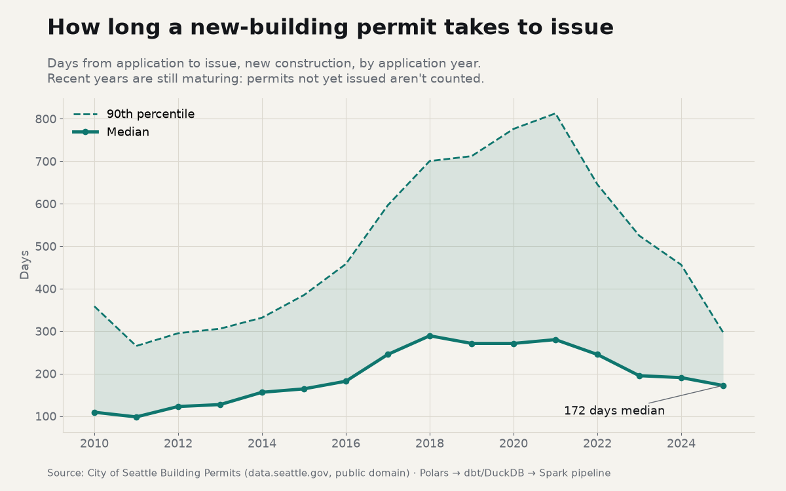</a><p><b><a href="data-engineering/seattle-permits-dbt-duckdb/">Seattle Permits Warehouse (dbt + DuckDB)</a></b><br/>Independent build · public data</p></td>
<td width="33%" valign="top"><a href="data-engineering/seattle-permits-spark/">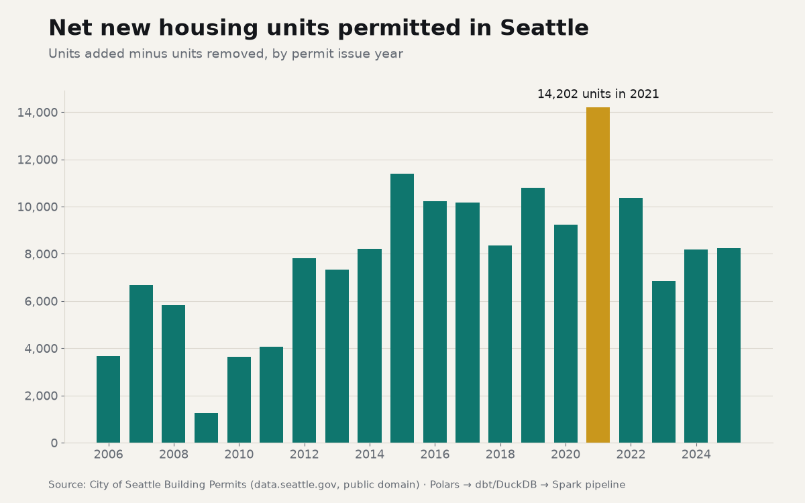</a><p><b><a href="data-engineering/seattle-permits-spark/">Seattle Permits on Spark (PySpark + Scala)</a></b><br/>Independent build · public data</p></td>
</tr>
<tr>
<td width="33%" valign="top"><a href="clients/multi-company-construction-enterprise/enterprise-wip-command-center/"></a><p><b><a href="clients/multi-company-construction-enterprise/enterprise-wip-command-center/">Enterprise WIP Command Center</a></b><br/>Multi-company construction enterprise</p></td>
<td width="33%" valign="top"><a href="clients/regional-heavy-civil-contractor/ticket-desk/">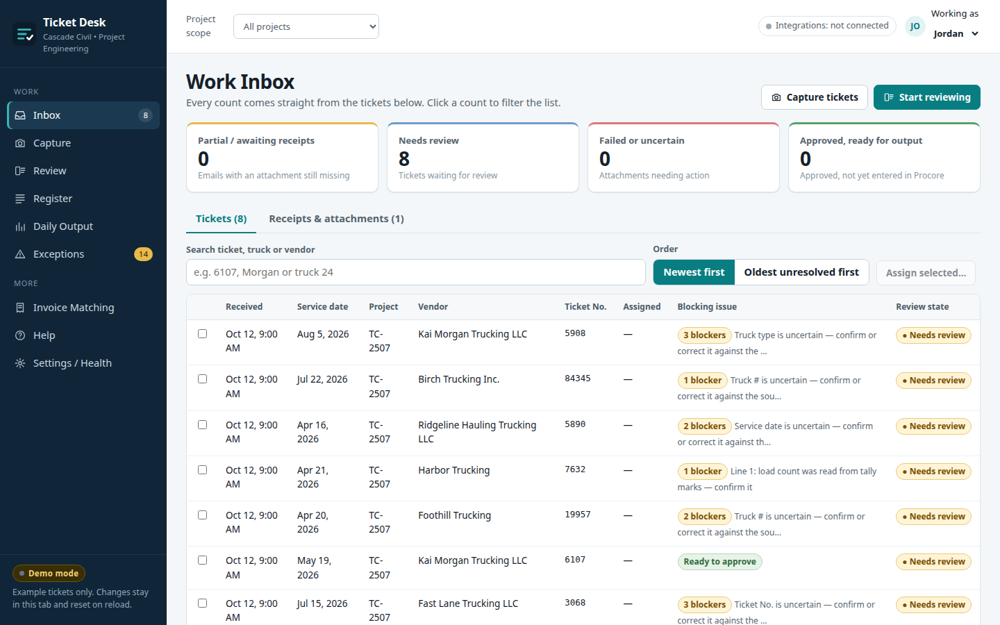</a><p><b><a href="clients/regional-heavy-civil-contractor/ticket-desk/">Ticket Desk: Trucking Ticket Intake & Review</a></b><br/>Regional heavy-civil contractor</p></td>
<td width="33%" valign="top"><a href="clients/regional-sports-commission/wc2026-seattle-economic-dashboard/"></a><p><b><a href="clients/regional-sports-commission/wc2026-seattle-economic-dashboard/">FIFA World Cup 2026 Seattle Economic Impact Dashboard</a></b><br/>Regional sports commission</p></td>
</tr>
<tr>
<td width="33%" valign="top"><a href="clients/regional-sports-commission/follow-the-dollar-teaching-story/">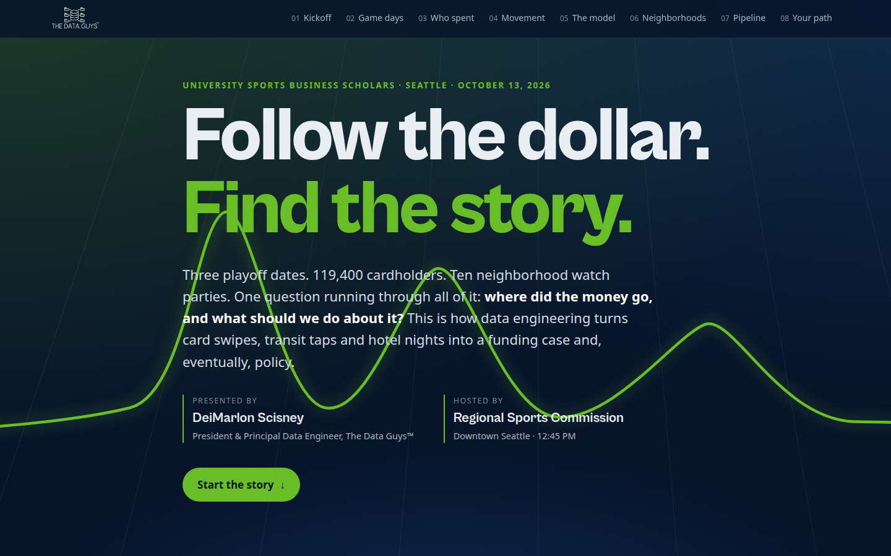</a><p><b><a href="clients/regional-sports-commission/follow-the-dollar-teaching-story/">Follow the Dollar: Seattle Sports, Data & Policy</a></b><br/>Regional sports commission × university program</p></td>
<td width="33%" valign="top"><a href="clients/municipal-community-council-study/community-survey-platform/"></a><p><b><a href="clients/municipal-community-council-study/community-survey-platform/">Community Council Feasibility Survey Platform</a></b><br/>Municipal feasibility study</p></td>
<td width="33%" valign="top"><a href="clients/community-cooperative/operations-lending-impact-platform/"></a><p><b><a href="clients/community-cooperative/operations-lending-impact-platform/">Co-op Operations, Lending & Impact Platform</a></b><br/>Community lending cooperative</p></td>
</tr>
<tr>
<td width="33%" valign="top"><a href="clients/youth-technology-nonprofit/impact-dashboard/">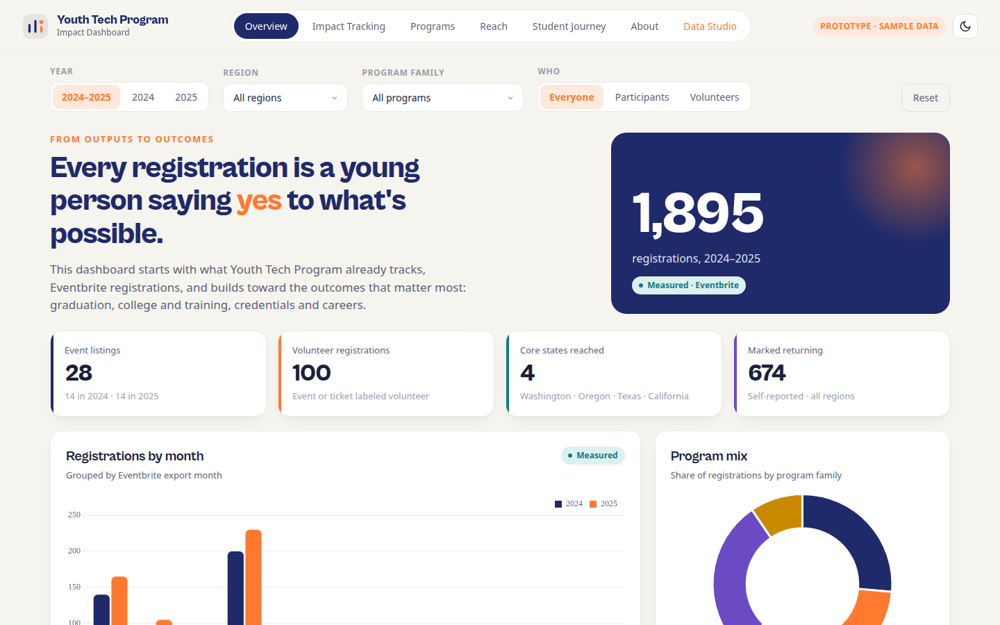</a><p><b><a href="clients/youth-technology-nonprofit/impact-dashboard/">Youth Program Impact Dashboard</a></b><br/>Youth technology nonprofit</p></td>
<td width="33%" valign="top"><a href="clients/neighborhood-park-nonprofit/park-impact-hub/">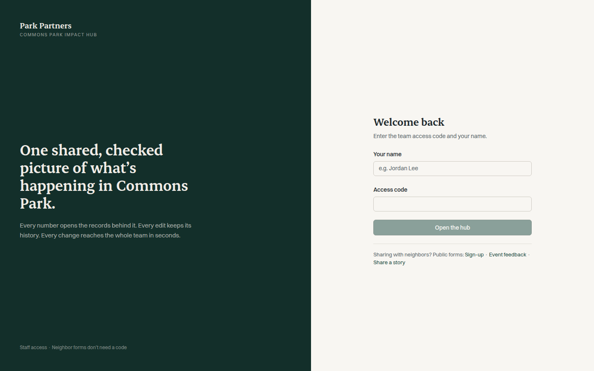</a><p><b><a href="clients/neighborhood-park-nonprofit/park-impact-hub/">Park Impact Hub</a></b><br/>Neighborhood park nonprofit</p></td>
<td width="33%" valign="top"><a href="clients/community-network-coalition/community-intelligence-hub/">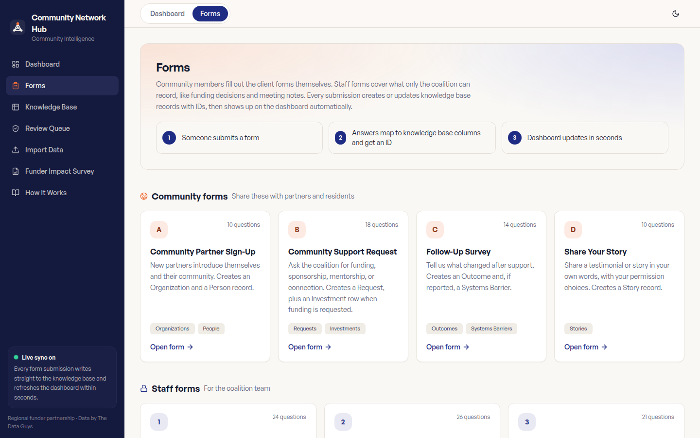</a><p><b><a href="clients/community-network-coalition/community-intelligence-hub/">Community Intelligence Hub</a></b><br/>Community network coalition</p></td>
</tr>
<tr>
<td width="33%" valign="top"><a href="clients/public-services-agency/asana-implementation-walkthrough/">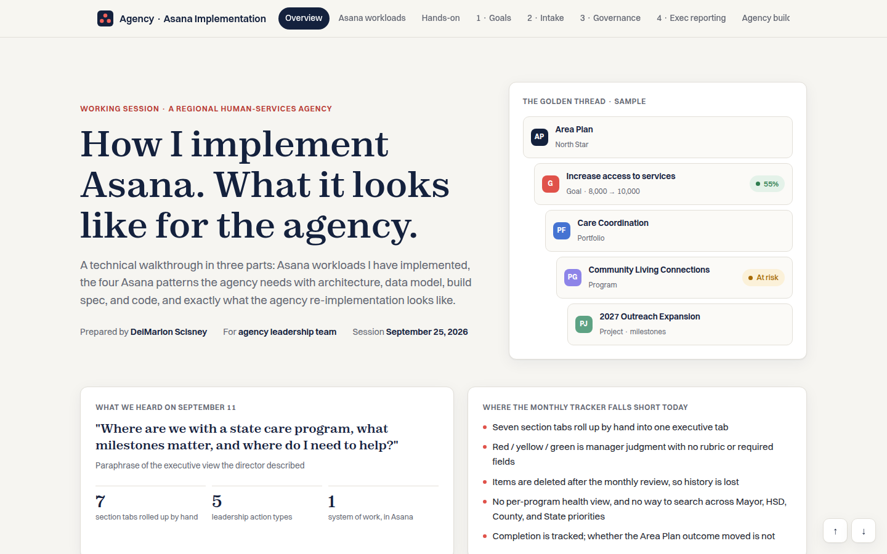</a><p><b><a href="clients/public-services-agency/asana-implementation-walkthrough/">Asana Implementation Walkthrough</a></b><br/>Regional human-services agency</p></td>
</tr>
</table>

## Projects by client

Client identities are anonymized. See the [confidentiality policy](docs/CONFIDENTIALITY.md).

### Data Engineering: Seattle Permits Data Platform (independent build, public data)

| Project | Stack | Live demo |
|---|---|---|
| [Seattle Permits Pipeline (Polars)](data-engineering/seattle-permits-polars-pipeline/) | Python 3.12, Polars 2.0, Parquet, PyArrow | — |
| [Seattle Permits Warehouse (dbt + DuckDB)](data-engineering/seattle-permits-dbt-duckdb/) | dbt-core 1.12, DuckDB, SQL, Jinja | — |
| [Seattle Permits on Spark (PySpark + Scala)](data-engineering/seattle-permits-spark/) | Apache Spark 3.5, PySpark, Scala 2.12, sbt | — |

### Multi-Company Construction Enterprise

| Project | Stack | Live demo |
|---|---|---|
| [Enterprise WIP Command Center](clients/multi-company-construction-enterprise/enterprise-wip-command-center/) | TypeScript, React 18, Vite, Express | — |

### Regional Heavy-Civil Contractor

| Project | Stack | Live demo |
|---|---|---|
| [Ticket Desk: Trucking Ticket Intake & Review](clients/regional-heavy-civil-contractor/ticket-desk/) | JavaScript (ES2022), HTML5, CSS3, JSON data contracts | [Open](https://dthedataguy.github.io/the-data-guys-portfolio/demos/ticket-desk/) |
| [Month-End Close & Forecast Hub (case study)](clients/regional-heavy-civil-contractor/close-forecast-hub/) | React, TypeScript, Excel / Costpoint GL, Power BI | — |

### Aerospace NDT Parts Distributor

| Project | Stack | Live demo |
|---|---|---|
| [RFQ-to-Catalog Item Matching Engine](clients/aerospace-ndt-distributor/rfq-item-matching-engine/) | Python, pandas, regex, difflib, T-SQL | — |

### Regional Sports Commission

| Project | Stack | Live demo |
|---|---|---|
| [FIFA World Cup 2026 Seattle Economic Impact Dashboard](clients/regional-sports-commission/wc2026-seattle-economic-dashboard/) | HTML5, JavaScript, Chart.js, CSS3 | [Open](https://dthedataguy.github.io/the-data-guys-portfolio/demos/world-cup-economic-dashboard/) |
| [Follow the Dollar: Seattle Sports, Data & Policy](clients/regional-sports-commission/follow-the-dollar-teaching-story/) | HTML5, JavaScript, Chart.js, CSS3 | [Open](https://dthedataguy.github.io/the-data-guys-portfolio/demos/follow-the-dollar/) |

### Municipal Community-Council Feasibility Study

| Project | Stack | Live demo |
|---|---|---|
| [Community Council Feasibility Survey Platform](clients/municipal-community-council-study/community-survey-platform/) | TypeScript, React 18, Vite, Express | — |

### Regional Human-Services Agency

| Project | Stack | Live demo |
|---|---|---|
| [Asana Implementation Walkthrough](clients/public-services-agency/asana-implementation-walkthrough/) | HTML5, CSS3, JavaScript | [Open](https://dthedataguy.github.io/the-data-guys-portfolio/demos/asana-walkthrough/) |

### Community Lending Cooperative

| Project | Stack | Live demo |
|---|---|---|
| [Co-op Operations, Lending & Impact Platform](clients/community-cooperative/operations-lending-impact-platform/) | TypeScript, React 18, Vite, Express | — |

### Youth Technology Nonprofit

| Project | Stack | Live demo |
|---|---|---|
| [Youth Program Impact Dashboard](clients/youth-technology-nonprofit/impact-dashboard/) | JavaScript, HTML5, CSS3, CSV import | [Open](https://dthedataguy.github.io/the-data-guys-portfolio/demos/youth-program-impact/) |

### Neighborhood Park Nonprofit

| Project | Stack | Live demo |
|---|---|---|
| [Park Impact Hub](clients/neighborhood-park-nonprofit/park-impact-hub/) | React, TypeScript, Vite, Tailwind CSS | — |

### Community Network Coalition

| Project | Stack | Live demo |
|---|---|---|
| [Community Intelligence Hub](clients/community-network-coalition/community-intelligence-hub/) | React, TypeScript, Vite, Tailwind CSS | — |
| [Microsoft Forms + Power Automate + Excel Knowledge Base](clients/community-network-coalition/microsoft-forms-system/) | Microsoft Forms, Power Automate, SharePoint, Excel | — |

## Technical capabilities

| Area | Demonstrated in |
|---|---|
| **Data pipelines** (Polars medallion, PySpark and Scala Spark, API ingestion with retries and hash manifests) | Seattle Permits Data Platform |
| **Analytics engineering** (dbt on DuckDB, incremental models, enforced contracts, SCD2 snapshots, 48 tests) | Seattle Permits Warehouse |
| **Python data processing** (pandas, regex extraction, fuzzy matching, pytest) | RFQ Item Matching Engine |
| **SQL & relational modeling** (T-SQL schema design, filtered indexes, audit tables; ~280 hand-written SQLite queries inside the TypeScript services) | RFQ schema, Enterprise WIP, Co-op platform, Community Survey |
| **Full-stack TypeScript** (React 18, Vite, Express, Drizzle ORM, Zod, TanStack Query) | Enterprise WIP, Co-op platform, Community Survey |
| **Data modeling & governed calculations** | `shared/calc.ts`, `shared/recon.ts` (WIP); `shared/contracts.ts` (Co-op); `shared/analytics.ts` (Survey) |
| **ETL / spreadsheet ingestion** (header aliasing, provenance, preview-before-commit, row-level errors) | WIP importer, Co-op import pipeline, Youth Program Data Studio |
| **Financial systems & month-end close** (WIP, EAC, ITD true-up, over/under-billing, bonding) | Enterprise WIP, Close & Forecast Hub, Ticket Desk |
| **ERP / construction integrations** (Costpoint, Snowflake, HCSS HeavyJob, Procore) | Enterprise WIP, Ticket Desk specification |
| **Privacy & security engineering** (RBAC, k-anonymity suppression, separated PII stores, release gating, security review) | Community Survey, Co-op platform |
| **Data visualization & storytelling** (Chart.js, Recharts, scroll narratives) | WC2026 dashboard, Follow the Dollar, Park Impact Hub |
| **Economic-impact modeling** (multi-method triangulation, evidence registers) | WC2026 Seattle Economic Impact Dashboard |
| **Low-code automation** (Microsoft Forms, Power Automate, SharePoint/Excel) | Community Network Coalition forms system |
| **Data quality in CI** (pytest, ScalaTest, dbt tests, four-engine parity in GitHub Actions) | Seattle Permits Data Platform |

## Language breakdown

| Language | Authored lines | Share |
|---|---:|---:|
| TypeScript | 19,446 | 58.7% |
| HTML | 6,818 | 20.6% |
| JavaScript | 2,513 | 7.6% |
| CSS | 1,849 | 5.6% |
| Python | 1,633 | 4.9% |
| SQL | 699 | 2.1% |
| Scala | 182 | 0.5% |
| **Total** | **33,140** | |

Counts cover authored source only and exclude third-party UI primitives, lockfiles and compiled production bundles. SQL also lives inside the TypeScript services (about 280 hand-written queries), which these counts file under TypeScript.

## Repository structure

```
.
├── data-engineering/             # Seattle Permits Data Platform: Polars · dbt + DuckDB · PySpark · Scala Spark
│   ├── seattle-permits-polars-pipeline/
│   ├── seattle-permits-dbt-duckdb/
│   └── seattle-permits-spark/                # pyspark_job/ · scala_job/ (sbt) · parity/
├── clients/                      # Client engagements, one folder per (anonymized) organization
│   ├── multi-company-construction-enterprise/   # Enterprise WIP Command Center
│   ├── regional-heavy-civil-contractor/         # Ticket Desk · Close & Forecast Hub
│   ├── aerospace-ndt-distributor/               # RFQ item matching engine (Python · T-SQL)
│   ├── regional-sports-commission/              # WC2026 dashboard · Follow the Dollar teaching story
│   ├── municipal-community-council-study/       # Community survey platform
│   ├── public-services-agency/                  # Asana implementation walkthrough
│   ├── community-cooperative/                   # Operations, lending & impact platform
│   ├── youth-technology-nonprofit/              # Youth program impact dashboard
│   ├── neighborhood-park-nonprofit/             # Park impact hub
│   └── community-network-coalition/             # Community intelligence hub · Forms system
├── .github/workflows/            # CI: pytest, dbt build, PySpark tests, sbt test
└── docs/                         # Portfolio site, live demos (docs/demos/), principles, case studies, confidentiality
```

Every project folder has its own `README.md` covering the overview, stack, engineering highlights, code footprint and how to run it.

## Additional documentation

- [Engineering principles](docs/ENGINEERING_PRINCIPLES.md)
- [Case studies without published code](docs/CASE_STUDIES.md)
- [Confidentiality & redaction policy](docs/CONFIDENTIALITY.md)

## Contact

**Dei'Marlon Scisney** · The Data Guys · [thedataguys.org](https://thedataguys.org) · info@thedataguys.org

---

<sub>© 2026 The Data Guys. All rights reserved. This code is published for portfolio review. See [LICENSE](LICENSE).</sub>
