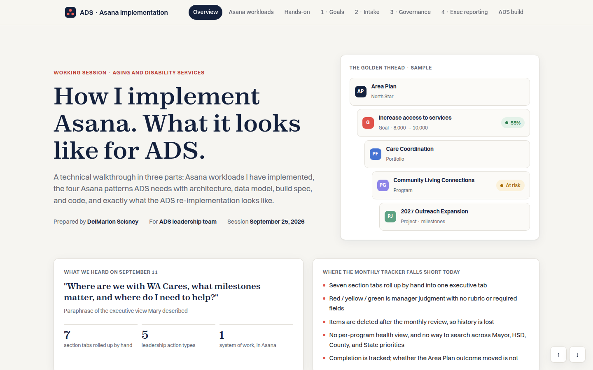

# Asana Implementation Walkthrough

**Client / organization:** ADS  
**Built by:** Dei'Marlon Scisney · The Data Guys



## Overview

A self-contained, offline-capable interactive walkthrough of an Asana work-management implementation: project structure, workflows and adoption steps.

## Tech stack

`HTML5` · `CSS3` · `JavaScript`

## Engineering highlights

- Single-file deliverable that works without a network connection.

## Run it

No build step. Serve the folder and open it in a browser:

```bash
python3 -m http.server 8000
# http://localhost:8000
```

## Code footprint

| Language | Authored lines |
|---|---:|
| HTML | 1,362 |

