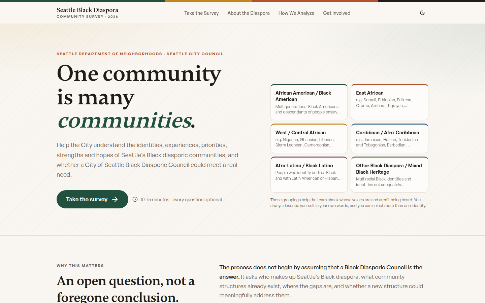

# Seattle Black Diasporic Community Survey Platform

**Client / organization:** City of Seattle: Black Diasporic Council feasibility  
**Live deployment:** [seattle-diaspora-survey.pplx.app](https://seattle-diaspora-survey.pplx.app)  
**Built by:** Dei'Marlon Scisney · The Data Guys



## Overview

A public survey plus a separate, restricted executive dashboard that informs whether and how to form a City of Seattle Black Diasporic Council. Responses and opt-in contact details are stored separately, and no results are exposed to unauthenticated visitors.

## Tech stack

`TypeScript` · `React 18` · `Vite` · `Express` · `SQLite` · `Drizzle ORM` · `Recharts` · `Tailwind CSS` · `shadcn/ui`

## Engineering highlights

- **Versioned survey instrument** (`shared/survey.ts`): stable question IDs (Q01–Q37), stored option codes, and display labels keyed by language, so translations never change stored data.
- **Every dashboard number is computed** from stored responses in `shared/analytics.ts`. Nothing is hard-coded.
- **Privacy by design**: small-cell suppression (k = 5), separate contact store, and collection/internal/public release modes.
- **Representation tracking**: target sample by group against a planning population, with under-, on- and over-target status thresholds.
- **Staff tools**: paper entry, coded open-ended responses, collection links by channel, imports/exports, audit-logged settings, role-based access.
- **Save-and-resume** public sessions with progress checkpoints; 42 REST endpoints.

## Code footprint

| Language | Authored lines |
|---|---:|
| TypeScript | 4,340 |
| CSS | 261 |
| HTML | 15 |
| JavaScript | 6 |

shadcn/ui primitives in `components/ui` and compiled builds are not counted.

## Run locally

```bash
npm install
npm run dev
```

## Confidentiality

Staff credentials file excluded.
