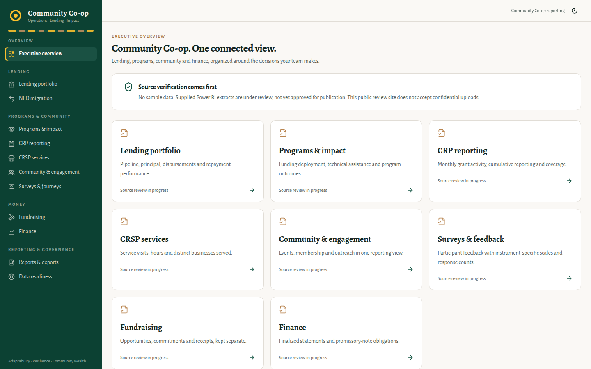

# Co-op Operations, Lending & Impact Platform

**Client / organization:** Community lending cooperative (anonymized)  
**Built by:** Dei'Marlon Scisney · The Data Guys



## Overview

A unified operations and impact-reporting platform for a community lending co-op, covering loan servicing and a lending-system migration, programs and impact, events, surveys, fundraising and finance, with role-based views for admins, lending, programs, finance, leadership and board/funders.

## Tech stack

`TypeScript` · `React 18` · `Vite` · `Express` · `SQLite` · `Drizzle ORM + drizzle-zod` · `Zod` · `Recharts` · `Tailwind CSS` · `shadcn/ui` · `Multer`

## Engineering highlights

- **Contract-driven architecture** (`shared/contracts.ts`): each dataset declares its grain, keys, source, owner and field contract. Forms, import mapping, validation, templates and the data dictionary are all generated from one registry.
- **One versioned, auditable record store** (`shared/schema.ts`) keyed by dataset contract.
- **Import pipeline**: parse → map legacy/misspelled headers via aliases → validate → row-level error report → commit.
- **KPI and report engine** (`server/metrics.ts`, `server/dashboards.ts`) with dataset and KPI exports.
- **Acceptance and smoke tests** (`server/acceptance.ts`, `script/smoke.ts`), plus a written security review.
- **Release gating** (`shared/release.ts`): public writes and role impersonation stay disabled until server-verified auth ships.
- 18 application pages; 35 REST endpoints.

## Code footprint

| Language | Authored lines |
|---|---:|
| TypeScript | 8,880 |
| CSS | 329 |
| HTML | 17 |
| JavaScript | 6 |

shadcn/ui primitives in `components/ui` and compiled builds are not counted.

## Run locally

```bash
npm install
npm run dev
```

## Confidentiality

Client identity is anonymized. Built and demonstrated with labeled demo data.
