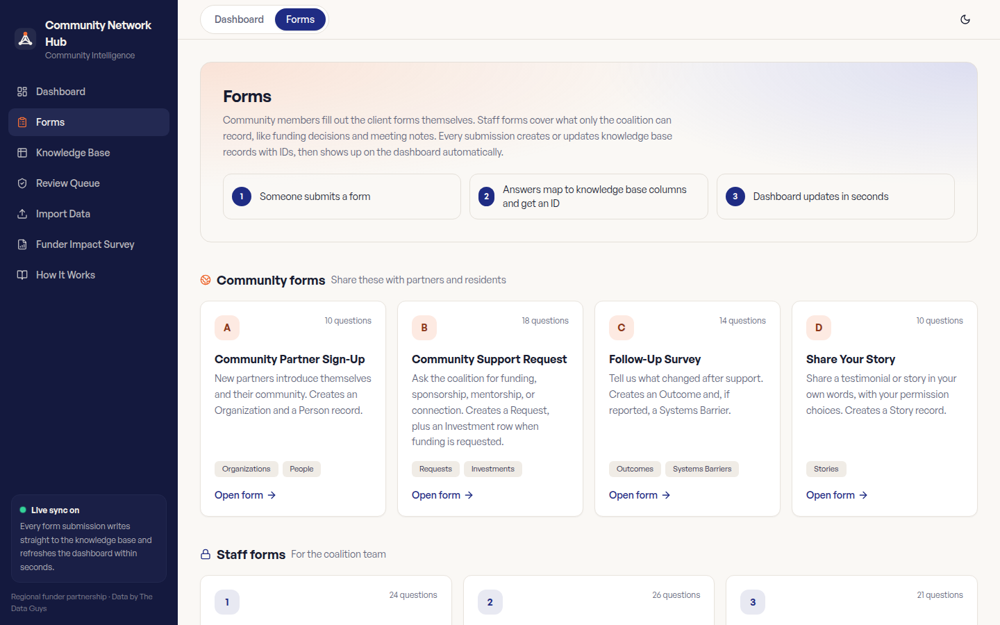

# Community Intelligence Hub

**Client / organization:** Community network coalition (anonymized)  
**Built by:** Dei'Marlon Scisney · The Data Guys



## Overview

A client/staff hub that routes partner and staff submissions into linked records, a review queue, a live dashboard and Excel exports.

## Tech stack

`React` · `TypeScript` · `Vite` · `Tailwind CSS`

## Engineering highlights

- Four client-facing forms kept separate from nine staff forms.
- Linked records across organizations, requests, outcomes, funding, projects and events.
- Companion production design in `../microsoft-forms-system/`.

## Run it

`production-build/` is the compiled front-end bundle. The application source and its API service are held privately for the client, so screens past the sign-in and public forms need that service. To view the bundle locally:

```bash
npx serve production-build
```

## Confidentiality

Published production build (compiled bundle). Organization, place and people names are fictional.
