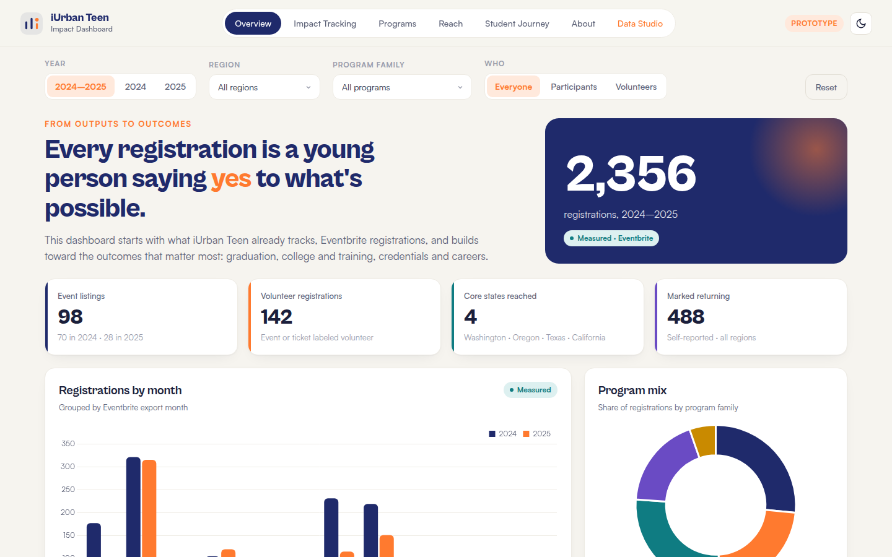

# iUrban Teen Impact Dashboard

**Client / organization:** iUrban Teen  
**Live deployment:** [iurbanteen-impact.pplx.app](https://iurbanteen-impact.pplx.app)  
**Built by:** Dei'Marlon Scisney · The Data Guys



## Overview

A public prototype for the Executive Council that traces program reach from Eventbrite registrations toward longer-term student outcomes.

## Tech stack

`JavaScript` · `HTML5` · `CSS3` · `CSV import`

## Engineering highlights

- Combines 2,356 registration records across 2024–2025 exports, labeled as registrations, not unique students or check-ins.
- Program, reach and Impact Tracking views; Data Studio for CSV imports and outcome entry.
- Separates outputs from outcomes so the council doesn't overclaim.

## Run it

No build step. Serve the folder and open it in a browser:

```bash
python3 -m http.server 8000
# http://localhost:8000
```

## Code footprint

| Language | Authored lines |
|---|---:|
| JavaScript | 459 |
| HTML | 341 |
| CSS | 245 |

## Confidentiality

Aggregated figures only; no attendee records.
