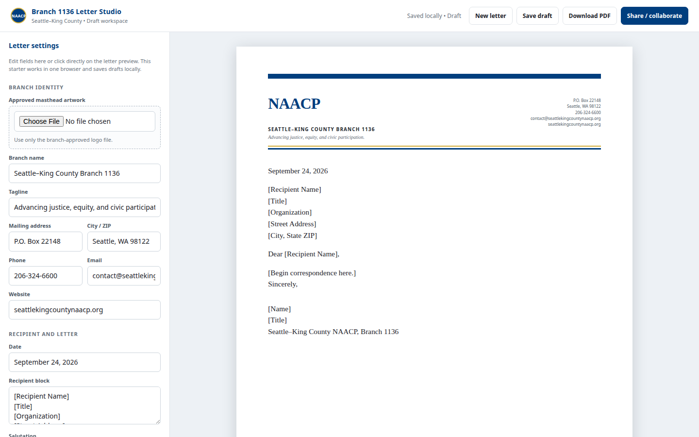

# Branch 1136 Letter Studio

**Client / organization:** Seattle–King County NAACP, Branch 1136  
**Built by:** Dei'Marlon Scisney · The Data Guys



## Overview

A branded correspondence editor: masthead and contact fields, recipient, subject, body, signer and review status, with print-to-PDF output.

## Tech stack

`HTML5` · `JavaScript` · `CSS3 (print media)` · `localStorage`

## Engineering highlights

- Device-local draft persistence.
- Print-accurate letterhead layout via CSS print media.
- `v1-letter-studio.html` shows the earlier iteration.

## Run it

No build step. Serve the folder and open it in a browser:

```bash
python3 -m http.server 8000
# http://localhost:8000
```

`v1-letter-studio.html` is the first version, kept for comparison.

## Code footprint

| Language | Authored lines |
|---|---:|
| HTML | 310 |

