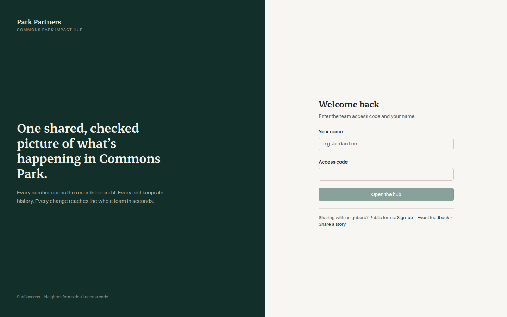

# Park Impact Hub

**Client / organization:** Neighborhood park nonprofit (anonymized)  
**Built by:** Dei'Marlon Scisney · The Data Guys



## Overview

A data-management and impact-reporting hub: restricted staff dashboards and editing, open neighbor forms, review workflows, imports/exports and record-level provenance across residents, investments, housing, volunteers, programs, events and neighborhood goals.

## Tech stack

`React` · `TypeScript` · `Vite` · `Tailwind CSS`

## Engineering highlights

- Every metric drills into its supporting records.
- Evidence labels: Confirmed, Updated definition, Provisional, Snapshot.
- Non-destructive weekly refresh from Excel/CSV files with changing layouts.

## Run it

`production-build/` is the compiled front-end bundle. The application source and its API service are held privately for the client, so screens past the sign-in and public forms need that service. To view the bundle locally:

```bash
npx serve production-build
```

## Confidentiality

Published production build (compiled bundle). Organization, place and people names are fictional.
