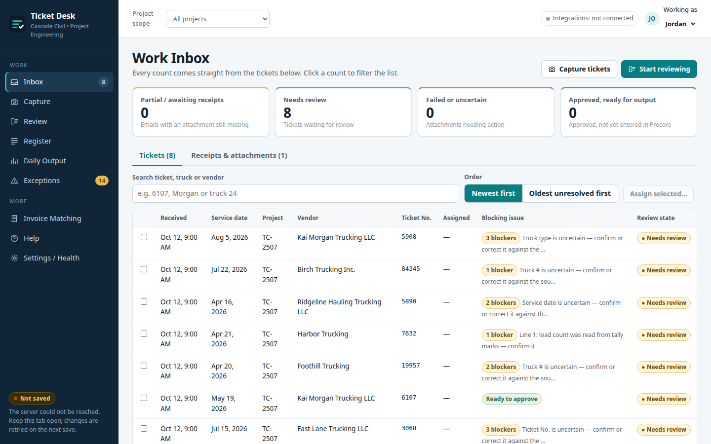

# Ticket Desk: Trucking Ticket Intake & Review

**Client / organization:** Regional heavy-civil contractor (anonymized)  
**Built by:** Dei'Marlon Scisney · The Data Guys



## Overview

A ticket-intake, evidence, review and downstream-entry workspace for project engineering. Trucking and material tickets from many vendor layouts are captured, reviewed, approved as versions, and prepared as daily entries for HCSS HeavyJob and Procore.

## Tech stack

`JavaScript (ES2022)` · `HTML5` · `CSS3` · `JSON data contracts` · `CSV field mapping`

## Engineering highlights

- **Operating loop**: receive ticket → retain scan and receipt → review values → resolve exceptions → approve a version → searchable register → prepare destination entries.
- **Fixed-point quantity math** (milli-units) to avoid floating-point drift on tonnage and loads.
- **Vendor-layout handling** across seven supplied ticket formats, with invoice matching.
- **System specification** ([`build-spec/SPECIFICATION.md`](build-spec/SPECIFICATION.md)): architecture, email intake contract, data model, state machines, validation rules, Procore boundary and acceptance tests, plus the field-mapping, decisions and integration worksheets. Procore writes are off by default.
- Pure client-side app (~1,650 lines of JS): no framework, fast load.

## Run it

The prototype runs on the synthetic tickets in `build-spec/`:

```bash
cd app && python3 -m http.server 8000
# http://localhost:8000
```

## Code footprint

| Language | Authored lines |
|---|---:|
| JavaScript | 1,651 |
| CSS | 282 |
| HTML | 36 |

## Confidentiality

Client, vendor, project and driver names are replaced with fictional ones. Private source tickets are excluded; only labeled DEMO data ships.
