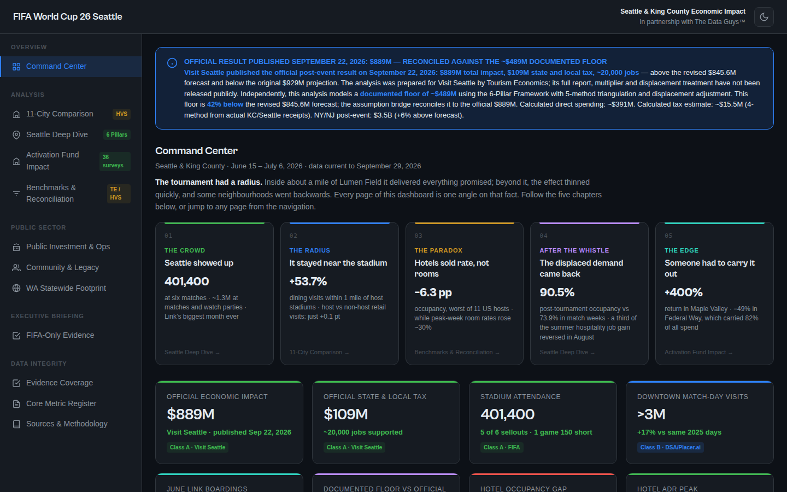

# FIFA World Cup 2026 Seattle Economic Impact Dashboard

**Client / organization:** Regional sports commission (anonymized)  
**Live demo:** [FIFA World Cup 2026 Seattle Economic Impact Dashboard](https://dthedataguy.github.io/the-data-guys-portfolio/demos/world-cup-economic-dashboard/)  
**Built by:** Dei'Marlon Scisney · The Data Guys



## Overview

A commissioner-facing evidence product for Seattle's FIFA World Cup 2026 footprint. It covers six pillars (visitation, visitor spending, lodging, mobility, tax generation, workforce) and keeps observed data, participant reports, calculations and provider-reported estimates in separate evidence classes.

## Tech stack

`HTML5` · `JavaScript` · `Chart.js` · `CSS3` · `Economic modeling`

## Engineering highlights

- **Five-method triangulation** of economic impact, with a bridge from the earlier model to Visit Seattle's reported $889M figure.
- **Metric register** with source, method and evidence class for every number.
- **Separate activation-program analysis** for partner-funded watch-party business activations.
- Single-file, dependency-light build (~4,400 lines) that can be emailed or hosted anywhere.

## Run it

Single-file build with no dependencies to install:

```bash
cd current && python3 -m http.server 8000
# http://localhost:8000
```

## Code footprint

| Language | Authored lines |
|---|---:|
| HTML | 4,371 |

