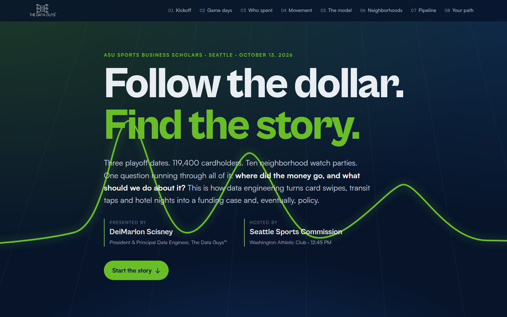

# Follow the Dollar: Seattle Sports, Data & Policy

**Client / organization:** Seattle Sports Commission × Arizona State University  
**Live deployment:** [seattle-sports-data-story.pplx.app](https://seattle-sports-data-story.pplx.app)  
**Built by:** Dei'Marlon Scisney · The Data Guys



## Overview

An interactive, story-led teaching site for ASU Sports Business Scholars. It shows how multiple sources become one account of dollars reaching businesses, how funding is allocated, and how data engineering informs policy.

## Tech stack

`HTML5` · `JavaScript` · `Chart.js` · `CSS3`

## Engineering highlights

- Scroll-driven narrative with live charts, replacing a static Looker dashboard while keeping its information.
- Teaches the full pipeline: source → model → evidence class → decision.
- Built for the Oct 13, 2026 Sports Business Scholars session at the Washington Athletic Club.

## Run it

No build step. Serve the folder and open it in a browser:

```bash
python3 -m http.server 8000
# http://localhost:8000
```

## Code footprint

| Language | Authored lines |
|---|---:|
| HTML | 660 |
| CSS | 435 |
| JavaScript | 381 |

