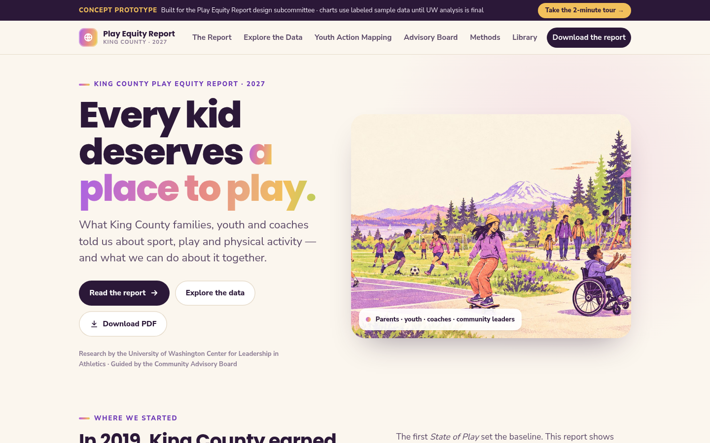

# King County Play Equity Interactive Report (concept)

**Client / organization:** University of Washington / King County Play Equity Coalition  
**Live deployment:** [kc-play-equity-report.pplx.app](https://kc-play-equity-report.pplx.app)  
**Built by:** Dei'Marlon Scisney · The Data Guys



## Overview

An interactive report concept for the King County State of Play youth sports study: five narrative chapters with live charts, a filtered data explorer, Youth Action Mapping, a Community Advisory Board video gallery, methods/privacy material and a supplemental-report library.

## Tech stack

`JavaScript` · `HTML5` · `CSS3` · `Data visualization` · `Print-ready PDF`

## Engineering highlights

- Data explorer with age, gender, region, income and language filters (top-5 → top-10 sports drill-down).
- Sample records clearly separated from the sourced 2019 State of Play baseline.
- Interactive and print sample PDFs in `downloads/`.

## Run it

No build step. Serve the folder and open it in a browser:

```bash
python3 -m http.server 8000
# http://localhost:8000
```

## Code footprint

| Language | Authored lines |
|---|---:|
| JavaScript | 720 |
| HTML | 500 |
| CSS | 376 |

## Confidentiality

Contains illustrative sample data only.
