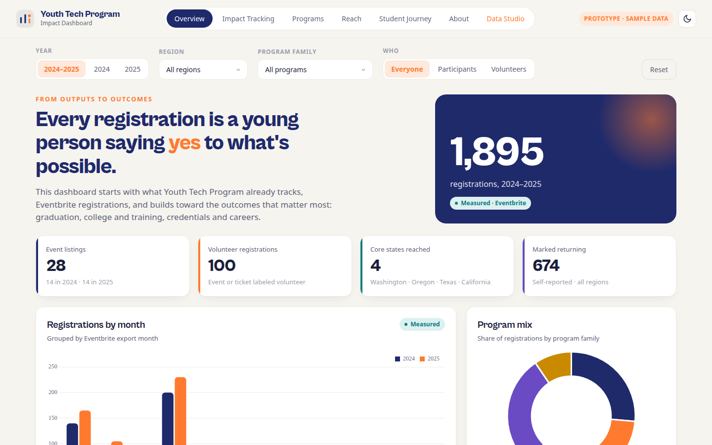

# Youth Program Impact Dashboard

**Client / organization:** Youth technology nonprofit (anonymized)  
**Live demo:** [Youth Program Impact Dashboard](https://dthedataguy.github.io/the-data-guys-portfolio/demos/youth-program-impact/)  
**Built by:** Dei'Marlon Scisney · The Data Guys



## Overview

A prototype for the executive council that traces program reach from event registrations toward longer-term student outcomes.

## Tech stack

`JavaScript` · `HTML5` · `CSS3` · `CSV import`

## Engineering highlights

- Combines registration exports across program years, labeled as registrations, not unique students or check-ins.
- Program, reach and Impact Tracking views; Data Studio for CSV imports and outcome entry.
- Separates outputs from outcomes so the council doesn't overclaim.

## Run it

No build step. Serve the folder and open it in a browser:

```bash
python3 -m http.server 8000
# http://localhost:8000
```

## Code footprint

| Language | Authored lines |
|---|---:|
| JavaScript | 459 |
| HTML | 341 |
| CSS | 245 |

## Confidentiality

The published demo runs on synthetic sample data (`data.json`). No attendee records are included.
