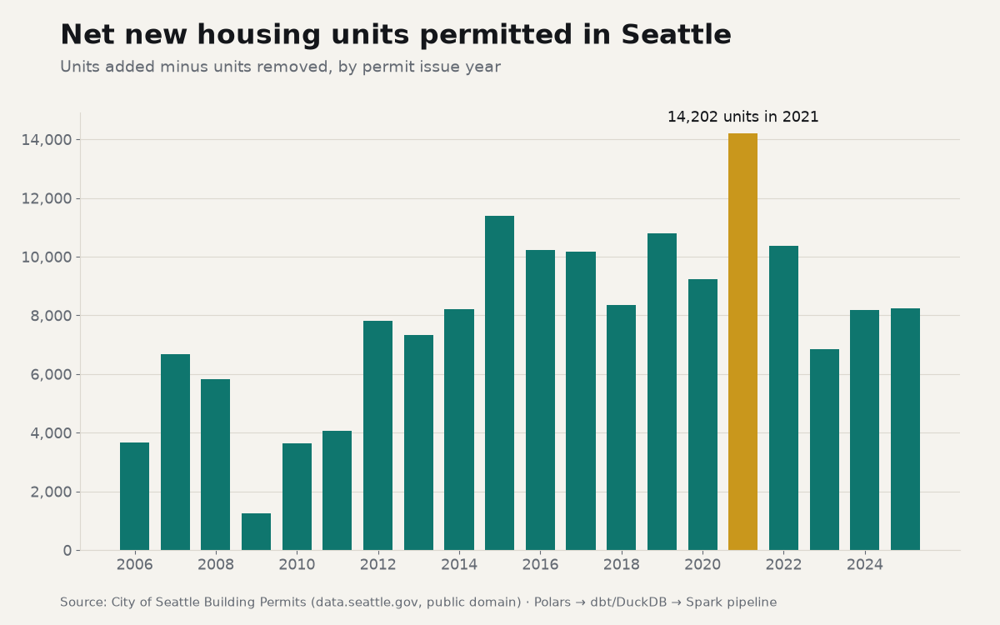
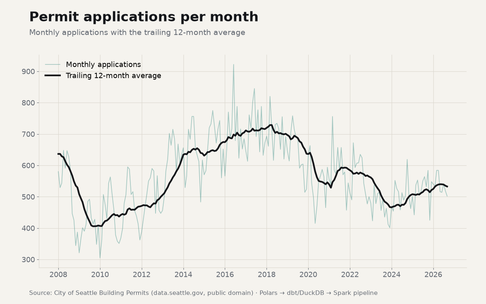

# Seattle Permits Data Platform

**Independent portfolio build on public data** · Dei'Marlon Scisney · The Data Guys

[](https://github.com/DTheDataGuy/the-data-guys-portfolio/actions/workflows/data-engineering.yml)

An end-to-end data-engineering platform over the City of Seattle's [Building Permits](https://data.seattle.gov/Built-Environment/Building-Permits/76t5-zqzr) open dataset: **193,747 permits** (public domain). The data is ingested from the live API, cleaned and contract-checked in **Polars**, modeled and tested in **dbt + DuckDB**, recomputed at scale in **PySpark** and **Scala Spark**, and proven consistent with a **four-engine parity check**.

This is not client work. It's a reproducible build that shows how I work as a data engineer: medallion layers, data contracts, quality gates, tested SQL, Spark in two languages, and numbers that reconcile.


## Results from the latest full run

| Stage | Engine | Output | Evidence |
|---|---|---|---|
| Ingest (bronze) | Python + requests | 193,747 rows · 4 API pages · SHA-256 manifest | [`run_manifest.json`](seattle-permits-polars-pipeline/reports/run_manifest.json) |
| Clean (silver) | Polars 2.0 (lazy) | 193,725 rows + 22 quarantined, with reasons | [`quality_report.md`](seattle-permits-polars-pipeline/reports/quality_report.md) |
| Quality gate | Polars | 17 checks: 8 blocking all pass; 1 warning raised (contractor coverage fell from 15.1% to 2.1%) | same |
| Gold | Polars | 5 tables, reconciled to silver | [`reports/gold/`](seattle-permits-polars-pipeline/reports/gold) |
| Warehouse | dbt 1.12 + DuckDB 1.5 | 10 models, 2 seeds, 1 SCD2 snapshot, 48 tests: **61/61 pass** | [`dbt_build_results.md`](seattle-permits-dbt-duckdb/reports/dbt_build_results.md) |
| Scale-out | PySpark 3.5 | 4 jobs · 193,725 rows · 15.1 s on `local[2]` | [`pyspark_run_summary.json`](seattle-permits-spark/reports/pyspark_run_summary.json) |
| Scale-out | Scala 2.12 Spark | typed Dataset jobs · 10.9 s on `local[2]` | [`scala_run_summary.json`](seattle-permits-spark/reports/scala_run_summary.json) |
| Parity | Polars = DuckDB = PySpark = Scala | 744 metric rows, 0 mismatches, max diff 5.7e-14 | [`parity_report.md`](seattle-permits-spark/reports/parity_report.md) |

`make all` runs the whole thing from the live API in **1 min 39 s** on a 2-CPU machine.

## Projects

| Folder | What it shows |
|---|---|
| [`seattle-permits-polars-pipeline/`](seattle-permits-polars-pipeline/) | Bronze/silver/gold medallion pipeline in Polars: paged API ingestion with retries, immutable extracts with hash manifests, a typed data contract, quarantine with reasons, a 17-check quality gate, gold reconciliation, CLI, 15 pytest tests |
| [`seattle-permits-dbt-duckdb/`](seattle-permits-dbt-duckdb/) | dbt project on DuckDB: sources with freshness SLAs, staging → intermediate → core → marts, an incremental fact with an enforced model contract, an SCD2 snapshot, custom generic tests, reconciliation tests, seeds as governed reference data |
| [`seattle-permits-spark/`](seattle-permits-spark/) | The same metrics in PySpark (window functions, exact percentiles, broadcast joins, AQE, partitioned output) and in Scala (typed `Dataset[Permit]`, `groupByKey`/`mapGroups`, hand-written percentile with ScalaTest), plus the cross-engine parity check |

## What the data says

| | |
|---|---|
|  |  |



- The median new-building permit took **289 days** to issue for 2018 applications, compared with **172 days** for 2025 applications. Recent years are still maturing, because permits that haven't been issued yet aren't counted.
- Seattle permitted a peak of **14,202 net new housing units in 2021**.
- The contractor field has largely stopped being filled in since 2021. The quality gate flags this as a warning so that no analysis quietly relies on it.

## Run it

```bash
make setup          # Python deps (Java 17 for Spark, sbt for Scala)
make all            # live API -> Polars -> dbt -> PySpark -> Scala -> parity -> charts
make replay         # rebuild everything from the last landed extract, no network
make test           # pytest (Polars + PySpark), ScalaTest, dbt build
```

CI ([`.github/workflows/data-engineering.yml`](../.github/workflows/data-engineering.yml)) runs the Polars tests, the pipeline on a committed fixture, `dbt build`, the PySpark tests and the Scala build + tests on every push.

## Engineering decisions

- **Bronze is all strings.** Typing happens in silver, where a failed cast becomes a flagged null or a quarantined row instead of a crashed load.
- **Nothing is silently dropped.** Every bronze row ends up in silver or in quarantine, with the names of the rules it broke. `bronze_rows_reconcile` checks that on every run.
- **Flags over deletes.** Placeholder 1900 dates, a $25B declared cost, bad ZIP codes and off-map coordinates are flagged and kept, and analytics exclude them on purpose.
- **One definition of a percentile.** Polars, DuckDB, Spark and the Scala code all use linear interpolation, so their results can be compared exactly instead of "close enough".
- **Privacy by design.** Some "contractors" in the source are private individuals, so no mart or report publishes contractor names, only concentration measures (top-10 share, HHI).

Data: City of Seattle, Seattle Department of Construction and Inspections, via data.seattle.gov (public domain).
