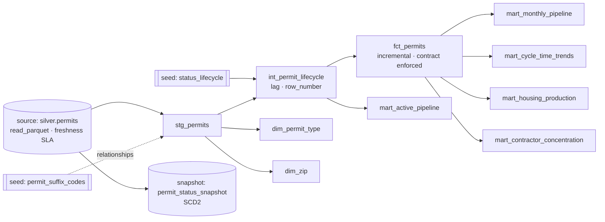

# Seattle Permits Warehouse (dbt + DuckDB)

**Independent portfolio build on public data** · Dei'Marlon Scisney · The Data Guys

`dbt-core 1.12` · `dbt-duckdb 1.11` · `DuckDB 1.5` · `SQL` · `Jinja`

A layered dbt project over the Polars silver output. It covers sources with freshness SLAs, staging, intermediate and core models, analytics marts, an enforced model contract, an incremental fact, an SCD2 snapshot and 48 tests. The latest `dbt build`: **61 / 61 nodes pass** ([results](reports/dbt_build_results.md)).



## Models

| Layer | Model | Technique |
|---|---|---|
| staging | `stg_permits` | renames and types; cost outliers nulled in `declared_value_usd`, raw value kept |
| intermediate | `int_permit_lifecycle` | seed join for lifecycle stage; `row_number()` / `lag()` per address for site history |
| core | `fct_permits` | **incremental** (`delete+insert`, 60-day look-back on last activity) with an **enforced contract** (29 typed columns, PK) |
| core | `dim_permit_type`, `dim_zip` | deterministic md5 surrogate key macro; permit-weighted ZIP centroids |
| marts | `mart_monthly_pipeline` | `generate_series` month spine, trailing 12-month window, YoY, partial-month flag |
| marts | `mart_cycle_time_trends` | `quantile_cont` p50/p90, `lag()` over a named window |
| marts | `mart_housing_production` | cumulative net units per ZIP, `rank()` within year |
| marts | `mart_contractor_concentration` | top-10 share and Herfindahl-Hirschman Index; no names published |
| marts | `mart_active_pipeline` | open permits by stage, median age |
| snapshot | `permit_status_snapshot` | Type 2 history on status and lifecycle dates |

## Tests (48)

- Generic: `unique`, `not_null`, `accepted_values`, `relationships` (fact → dims, staging → seeds).
- Custom generic tests in [`tests/generic/`](tests/generic/): `not_negative` and `date_not_before(other_column)`.
- Singular reconciliation tests in [`tests/singular/`](tests/singular/): source rows = fact rows; monthly mart total = dated fact rows; final cumulative housing = sum of yearly net; concentration bounds.
- A **status contract**: every status must exist in the `status_lifecycle` seed, so a new city status fails the build until it's mapped.

## Run

```bash
pip install -r ../requirements.txt
# needs ../seattle-permits-polars-pipeline/data/silver/permits.parquet (run the pipeline first)
DBT_PROFILES_DIR=. dbt build
DBT_PROFILES_DIR=. dbt source freshness
DBT_PROFILES_DIR=. dbt docs generate && DBT_PROFILES_DIR=. dbt docs serve
```

Override the input with `--vars '{silver_path: /path/to/permits.parquet}'`.
