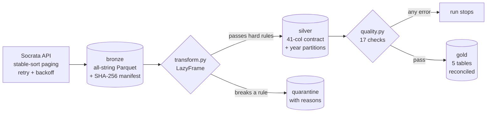

# Seattle Permits Pipeline (Polars)

**Independent portfolio build on public data** · Dei'Marlon Scisney · The Data Guys

`Python 3.12` · `Polars 2.0 (lazy API)` · `PyArrow / Parquet (zstd)` · `requests` · `pytest`

A bronze → silver → gold pipeline for the City of Seattle Building Permits dataset (193,747 rows, public domain). It's built for trust: every extract can be traced by hash, every row is accounted for, and a quality gate stops the run before bad data reaches gold.



## Latest run

| | |
|---|---|
| Bronze rows | 193,747 (4 pages, extract hash in [`run_manifest.json`](reports/run_manifest.json)) |
| Silver rows | 193,725 |
| Quarantined | 22 (14 issued before applied · 8 completed before issued) |
| Quality gate | **PASS**: all 8 blocking checks pass; 1 of 9 warnings raised ([report](reports/quality_report.md)) |
| Gold | `monthly_pipeline` 825 · `cycle_times` 124 · `housing_production` 620 · `contractor_concentration` 27 · `status_funnel` 74 |
| Runtime | silver + quality + gold in about 2–3 s; full run with download about 40 s |

## Layout

```
src/permits_pipeline/
  config.py      dataset id, paths, Seattle bounding box
  ingest.py      paged download, retries, flattening, bronze + manifest, hash-verified replay
  contracts.py   SILVER_CONTRACT (name, dtype, required, description) and HARD_RULES
  transform.py   lazy silver plan: typing, sentinel dates, ZIP/geo validation, dedupe, quarantine
  quality.py     17 checks (error | warn) -> quality_report.json + .md
  gold.py        5 gold tables computed with collect_all(), plus reconciliation to silver
  cli.py         `python -m permits_pipeline run --source api|file|replay [--as-of YYYY-MM-DD]`
tests/           15 tests: transforms, every hard rule, contract drift, gate failure, gold math
reports/         committed evidence from the latest run (quality, manifest, gold CSVs)
```

## Cleaning rules (all found in the real data)

| Problem in the source | Handling |
|---|---|
| `1900-01-01` used as "unknown date" (28 rows) | nulled, `flag_sentinel_date` |
| Declared cost of $25 billion (3 rows over $2B) | kept raw, `flag_cost_outlier`, excluded from value sums |
| ZIP codes like `70` or `98122-1234` | first 5 chars, must match `98xxx`, else null + `flag_bad_zip` |
| Coordinates outside Seattle | nulled, `flag_bad_geo` |
| Negative plan-review days | nulled |
| `N/A` permit class | explicit `Unclassified` category |
| Issued before applied, completed before issued | quarantined with the rule name |
| Socrata omits all-null columns on a page | missing columns added as typed nulls, so the contract never depends on luck |

## Run

```bash
pip install -e ".[dev]"                     # or: pip install -r ../requirements.txt
PYTHONPATH=src python -m permits_pipeline run --source api       # live
PYTHONPATH=src python -m permits_pipeline run --source replay    # rebuild from last extract (hash-checked)
PYTHONPATH=src python -m permits_pipeline run --source file --file tests/fixtures/permits_sample.json
PYTHONPATH=src python -m pytest -q
```

Silver feeds [the dbt project](../seattle-permits-dbt-duckdb/) and [the Spark jobs](../seattle-permits-spark/).
