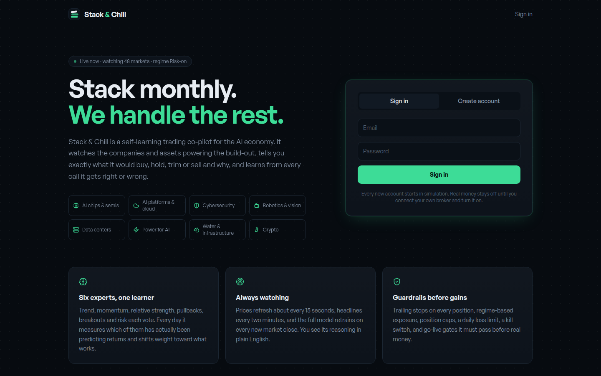

# Stack & Chill: Investing & Paper-Trading Platform

**Client / organization:** The Data Guys (personal product)  
**Live deployment:** [stackandchill.pplx.app](https://stackandchill.pplx.app)  
**Built by:** Dei'Marlon Scisney · The Data Guys



## Overview

A beginner-friendly investing platform that connects a monthly contribution plan to weekly portfolio review, research screens, Track It simulations and Alpaca paper-account automation.

## Tech stack

`React` · `TypeScript` · `Vite` · `Alpaca Paper Trading API` · `Tailwind CSS`

## Engineering highlights

- Paper trading before any live execution; real-money automation is gated.
- Signals are labeled as model judgments, not facts.
- Evolved from an earlier prototype named Keelright.

## Run it

`production-build/` is the compiled bundle as deployed; application source is held privately for the client. To view it locally:

```bash
npx serve production-build
```

## Confidentiality

Published production build (compiled bundle). No credentials included.
